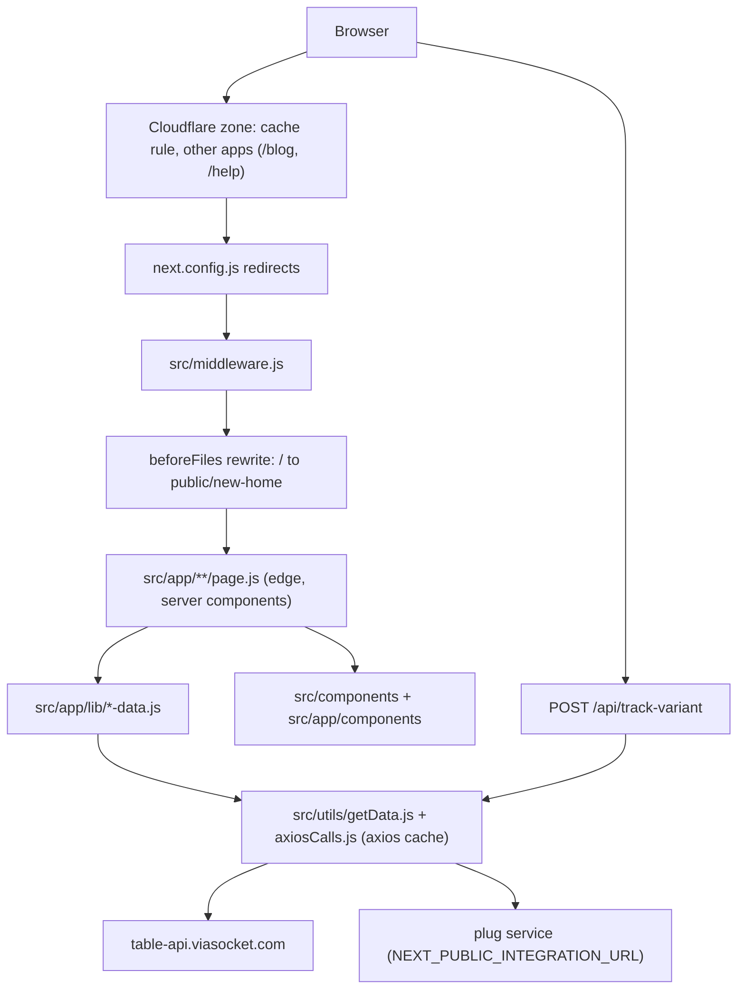

# Architecture & Mental Model

## Overview

The viaSocket marketing site is a read-mostly content site over two read APIs. A Next.js 15 App Router app in plain JavaScript renders every page at the edge, on each request, from table-api.viasocket.com (CMS-like content tables) and the plug service (apps, templates, combos). The homepage `/` is a separate hand-written static site in `public/new-home/`. The app is built with `@cloudflare/next-on-pages` and served from Cloudflare Pages: test.viasocket.com from the `test` branch, viasocket.com from `main`. Its only writes are form webhooks and a visitor-tracking table, and the tracking writes are switched off today.

This repo owns only some of the paths on viasocket.com. [05-navigation](05-navigation.md) has the route map, every redirect and rewrite, and the paths that other deployments serve.

## System Overview & Mental Model



### Layers

- **Edge entry:** the Cloudflare zone, `public/_redirects`, `next.config.js` redirects, `src/middleware.js` and the rewrites, in that order ([Request Path](#request-path-cloudflare-pages)).
- **Client:** either the static homepage or a React page that is server-rendered and then hydrated ([Client Layer](#client-layer)).
- **Aggregation:** there is no separate BFF. Each page's server component awaits one `src/app/lib/*-data.js` loader. The loader calls getters in `src/utils/getData.js`, and they call the HTTP layer `src/utils/axiosCalls.js`. The only internal API route is `POST /api/track-variant` ([api/track-variant](api/track-variant.md)).
- **Backends:** see [Core Systems](#core-systems).

### Data Flow (a typical request, `/pricing`)

1. On production the Cloudflare zone cache may answer first. Otherwise the Pages worker applies the redirects, then middleware sets `rdt_cid` and, in prod, fires the Reddit page-visit call.
2. `src/app/pricing/page.js` is an async server component on the edge runtime. It awaits `src/app/lib/pricing-data.js:getPricingPageData`, which runs eight getters at once with `Promise.all`. `generateMetadata` loads the title and OG tags from the same tables.
3. Each getter calls `src/utils/axiosCalls.js:getDataFromTable`. That sends the `auth-key` header to table-api, and the answer is cached in the isolate for 20 minutes. A failure calls `sendErrorMessage` and returns `undefined`, so that section renders empty and the page still returns 200.
4. The page renders the navbar, its sections and the footer from props, and the HTML goes back to the browser.
5. In the browser, `AppProvider` hydrates, writes `utmData`, and loads GTM, Zaraz and the chat widget. `VariantTracker` posts to `/api/track-variant`. Clicking an internal link starts a full page load, so the flow begins again at step 1.

## Integration Strategy

**The seam: pages never call backends themselves.** A page awaits its loader, the loader calls getters, and the getters call `src/utils/axiosCalls.js`. Components get their data as props; the three client-side exceptions are listed under [Observed dependency rules](#major-modules--responsibilities). Page copy, metadata and FAQs live in table-api, so they change without a deploy once the cache TTL runs out ([DECISIONS ADR-004](DECISIONS.md#adr-004-site-content-lives-in-table-api-not-in-the-repo)). The homepage-design pages are the exception: their copy is constants in `src/components/IntegrationsComp/addToProduct/copy.js`, and only app and blog data comes from the APIs.

Phases, as the commit history shows them (there is no written plan):

1. **Pages Router to App Router.** Done (`f5d90daa`, `d0f84519`, 2026-01; [ADR-003](DECISIONS.md#adr-003-migrate-from-the-pages-router-to-the-app-router)). Data loading moved from `getServerSideProps` into server-component loaders. <!-- verify:ignore -->
2. **Static homepage outside React.** Done (`12b97eb9`; [ADR-008](DECISIONS.md#adr-008-serve--from-the-static-site-in-publicnew-home)). `/` is `public/new-home/`, with its own tokens, GTM snippet and absolute links. Nothing in `src/` renders it.
3. **The homepage design rebuilt in Next.** In progress since 2026-10-19 (inferred from the commit run `10223c7c` to `00bfca2f`). `/integrations`, `/integrations/{app}`, `/features`, `/use-cases` and `/new-direction` render `src/components/IntegrationsComp/addToProduct/`, while every other page still uses the older component trees. Nothing records which pages move next ([VISION](VISION.md) open question 1).

Key invariant: **the edge runtime.** Every dynamic route exports `runtime = 'edge'`, and no Node API is available at request time ([below](#why-export-const-runtime--edge-is-everywhere)).

## Client Layer

- **Framework:** Next.js 15 App Router with React 18, in plain JavaScript. `/` is static HTML with ES5 JavaScript. Versions are in [06-tech-stack](06-tech-stack.md).
- **Styling:** Tailwind CSS with the daisyUI plugin (`tailwind.config.js`) plus the legacy global SCSS in `src/scss/global.scss`. The `addToProduct` pages and `/developers` use SCSS modules, and `/` uses `public/new-home/styles.css`. The five visual systems are described in [DESIGN](DESIGN.md).
- **UI Library:** none beyond daisyUI classes. Icons come from `lucide-react`. The component catalog is in [DESIGN](DESIGN.md#reusable-component-catalog).
- **Data Fetching:** server-only and at request time, through the `src/app/lib/*-data.js` loaders inside async server components. There is no client data library (no SWR or React Query) and no ISR. Caching is described in [14-performance](14-performance.md#fetching-strategy).

## Backend / Aggregation Layer

There is no gateway or BFF. Loaders run inside each page's server component, on the edge, and talk to the systems below through `src/utils/axiosCalls.js` (and `src/middleware.js` for the Reddit page-visit call). Endpoint shapes are in [CONTRACTS](CONTRACTS.md#backend-api-endpoints--contracts).

### Core Systems

1. **table-api.viasocket.com** (`src/utils/axiosCalls.js:getDataFromTable`, `src/const/tables.js`)
   - **Role:** the content tables (navbar, footer, meta, FAQs, features, pricing and more), the blog table and the A/B visitor table. The table catalog is in [database/entities](database/entities.md). Detail: [current-infrastructure/table-api](current-infrastructure/table-api.md).
   - **Auth:** an `auth-key` header carrying `NEXT_PUBLIC_DB_KEY`, `NEXT_PUBLIC_DB_KEY_ABTEST` or `NEXT_PUBLIC_BLOG_DB_KEY`. The base URL is `NEXT_PUBLIC_DB_BASE_URL` plus a database id hardcoded in the file.
2. **Plug service** (`NEXT_PUBLIC_INTEGRATION_URL`; `src/utils/axiosCalls.js:getCombos`, `getApps`, `getTemplates`; `src/middleware.js`)
   - **Role:** apps, templates, combos, the app count, the Reddit CAPI relay and the sitemap for dynamic pages. Detail: [current-infrastructure/plug-service](current-infrastructure/plug-service.md).
   - **Auth:** none. Requests send no key.
3. **flow.sokt.io webhooks** (`src/utils/SendErrorMessage.js:sendErrorMessage` and client form components)
   - **Role:** error reports, plus the support, feedback, request-integration, Black Friday and expert-meeting forms. Detail: [current-infrastructure/flow-webhooks](current-infrastructure/flow-webhooks.md).
   - **Auth:** none. The webhook URLs are hardcoded.
4. **Cloudflare** (`wrangler.toml`, `@cloudflare/next-on-pages`, zone rules outside the repo)
   - **Role:** hosting, the zone cache, Zaraz, and routing other deployments' paths. Detail: [current-infrastructure/cloudflare](current-infrastructure/cloudflare.md).
   - **Auth:** the Cloudflare dashboard, which this repo has no access to.
5. **Third-party services** (`src/app/layout.js`, `src/app/providers.js`, `src/components/headComp/headComp.js`, `src/app/components/customLogin/CustomLoginOptimized.js`)
   - **Role:** GTM `GTM-THTCRSLN`, Zaraz, the Reddit Pixel, cr-relay signals, Google Ads on campaign pages, the gtwy.ai chatbot and the MSG91 signup widget, plus link-outs to cal.id, Stripe and tally.so. Detail: [current-infrastructure/third-party-services](current-infrastructure/third-party-services.md).
   - **Auth:** public script and container ids only.

flow.viasocket.com, the product, is a link destination only. Signup and login hand off to it, and it sets the `prod` cookie ([FLOWS](FLOWS.md)).

## Request Path (Cloudflare Pages)

Next.js applies its routing phases in this order. `@cloudflare/next-on-pages` copies that order into the Pages worker. Each rule is listed in [05-navigation](05-navigation.md#redirects-rewrites-and-middleware).

1. **Cloudflare zone.** A zone cache rule lives outside the repo (see [DECISIONS](DECISIONS.md)). Production `/` is publicly cached for 3 hours ([14-performance](14-performance.md#known-hot-paths)), so check behaviour on production, not only on a local build.
2. **`public/_redirects`.** One `/faq/*` rule. `/faq` itself is answered by another deployment.
3. **`next.config.js` `redirects()`.** There is no `redirects()` function. Redirects are the middleware's job. The file still has the `beforeFiles` rewrite of `/` and the feedback `afterFiles` rewrites.
4. **`src/middleware.js:middleware`.** The matcher skips paths under _next/ and api/, and any path with a dot, and skips `/og/...`. Middleware does three things:
   - It applies the admin redirect list (`/api/public/redirects`, else `src/data/redirects.json`) and returns that status with an empty body. That is why `src/app/embed/page.js`, `src/app/mcp/page.js` and `src/app/home/page.js` never render. On production and test (2026-10-29) bare `/embed` is **301 to `/`**, not an alias of `/developers`. The fallback file still says 308 to `/developers`, which is not what those hosts return while the admin is reachable. Sub-routes such as `/embed/app-integration` and `/mcp/[...slug]` still render.
   - It sets `rdt_cid` from the `?rdt_cid=` query parameter.
   - When `NEXT_PUBLIC_PRODUCTION_ENVIRONMENT` is `prod`, it sends a Reddit CAPI page-visit to the plug service on every page request without awaiting the response.
5. **`beforeFiles` rewrite.** `/` maps to `/new-home/index.html`. Production shows `x-matched-path: /new-home/index.html` for `/`.
6. **Filesystem.** This covers `public/**` and the App Router routes. The `afterFiles` rewrites map `/feedback-satisfied` and `/feedback-unsatisfied` to `/feedback?variant=…`.

> [!WARNING]
> Middleware's `/` branch sets `Cache-Control: private, no-store` and `CDN-Cache-Control: no-store`. Its comment still says the homepage renders from the variant cookie. That stopped being true when `/` became static (commit `1f911f58`). Production `/` is publicly cached for 3 hours anyway. Do not trust this branch to keep anything out of the cache.

### Why `export const runtime = 'edge'` is everywhere

Every `page.js` and route handler that is not static exports `runtime = 'edge'`. That is 50 files, including `src/app/sitemap.js`, `src/app/robots.txt/route.js` and `src/app/api/track-variant/route.js`. Only the two static `success` pages, under `/agency-partner` and `/lifetime-deal`, leave it out. The reason is `@cloudflare/next-on-pages`: it can only deploy dynamic routes that run on the edge runtime (commit history: `956dadb8 runtime edge`, `cd6cc6a3 replace experimental-edge to edge`). This has three effects:
- **Rule:** a new dynamic `page.js` or `route.js` must export `runtime = 'edge'`, or the Pages build breaks.
- No Node APIs are available at request time. `next.config.js` sets the webpack fallback `fs: false`. Anything that reads the filesystem at runtime cannot work; the old `fs`-based blog loaders were removed for that reason (see [Blog content](#blog-content)).
- The `npm run build` route table marks every route `ƒ` (dynamic). Pages are never statically generated or served with ISR.

`wrangler.toml` (`nodejs_compat` only) is read by `wrangler pages dev|deploy`. The orphan `open-next.config.ts` from a reverted OpenNext experiment was removed on 2026-10-21 (see [DECISIONS](DECISIONS.md)). <!-- verify:ignore --> See [DEVELOPMENT](DEVELOPMENT.md) for the build and deploy commands.

## Entry Points & Bootstrap Sequence

**Static homepage (`/`).** It consists of `public/new-home/index.html`, `public/new-home/main.js` and `public/new-home/styles.css`. It is plain HTML and ES5 JavaScript with its own GTM snippet (`GTM-THTCRSLN`), canonical tag and JSON-LD. It does not load `src/app/layout.js`, `src/scss/global.scss`, Tailwind, Zaraz, `TrackingCookies` or `VariantTracker`. It loads the gtwy.ai chat itself through `public/new-home/assets/support.js` (opened by `[data-chat]` buttons). It also never calls `/api/track-variant`. Its links are absolute `https://viasocket.com/...` URLs.

**Unused React homepage.** `src/app/page.js` (A/B variants A and B, with B rendering `src/app/front-page/IndexPageContent.js`) and `src/app/home/page.js` (with `src/app/components/new-home/*`) still compile, but neither is reachable. Whether to keep them is open. Do not delete them ([OPEN_QUESTIONS](OPEN_QUESTIONS.md)).

**Every other route** goes through the root layout, `src/app/layout.js:RootLayout`:
1. It imports `src/scss/global.scss`, which applies to every React page.
2. `metadata` sets `robots: 'noindex, nofollow'` whenever `NEXT_PUBLIC_PRODUCTION_ENVIRONMENT` is not `prod`. This is how test.viasocket.com stays out of search results.
3. Inside `<head>` it renders the following:
   - `src/app/components/VariantTracker/TrackingCookies.js:TrackingCookies` is an inline ES5 script that writes the `variant` and `visitor_id` cookies before paint.
   - An Organization JSON-LD block.
   - The GTM `<noscript>` iframe.
   - `src/app/components/RedditPixel/RedditPixel.js`, which renders only in prod.
4. In `<body>` it renders:
   - `src/app/providers.js:AppProvider`, which wraps the page.
   - `src/app/components/VariantTracker/VariantTracker.js:VariantTracker`.
   - An inline loader for the cr-relay signals.js script.
5. `AppProvider` is the only global client wrapper. On mount it does the following:
   - Renders `src/components/headComp/headComp.js:HeadComp`, which sets the canonical link from the pathname on the client and injects the GTM script.
   - Renders `ChatWidget`.
   - Calls `src/utils/handleUtmSource.js:getUtmSource`, which stores `utm_*`, `affiliate_*` and `ref` query params in the `utmData` cookie (see [FLOWS](FLOWS.md)).
   - Calls `src/app/providers.js:loadZarazManually`, which loads `/cdn-cgi/zaraz/i.js`.
   - Injects the gtwy.ai chatbot script with a thread id kept in `localStorage` (`viasocket_chat_thread`, 1 h TTL).

> [!WARNING]
> `AppProvider` captures every click on a same-origin `<a>` that is not `_blank` and has no `#`. It calls `preventDefault()`, swaps the page for `src/app/providers.js:Skeleton` and then sets `window.location.href`. **Internal navigation is therefore always a full page load.** `next/link` client transitions, prefetch and shared client state across pages do not happen. To keep state across pages, use a cookie or `localStorage`. React state is lost on every page change.

**Navbar and footer.** The root layout does not render them; each page renders its own. Which page uses which header and footer is in [05-navigation](05-navigation.md#navigation-model). The usual pattern looks like this (see `src/app/pricing/page.js`):

```jsx
<ConditionalNavbar><NavbarServer navbarData={navbarData} utm={'/pricing'} /></ConditionalNavbar>
...
<ConditionalFooter><Footer footerData={footerData} /></ConditionalFooter>
```

- `src/app/components/navbar/NavbarServer.js:NavbarServer` is a server component. It reads the `prod` cookie to decide logged-in state and renders `NavbarOptimized`. It ignores its `navbarData` prop.
- `src/components/ConditionalLayout/ConditionalNavbar.js:ConditionalNavbar` and `ConditionalFooter` are client components. They hide their children on `integration.*`, `integrations.*` and `integrate.*` hosts (`src/utils/domain.js:isIntegrationSubdomain`). Until the effect runs they render their children with `display:none`, so the server HTML contains the navbar and footer but they stay hidden until JavaScript runs.

## Major Modules & Responsibilities

| Module / Layer | Path | Core Responsibility | Sources of Truth | May Depend On | Must NOT Depend On |
|---|---|---|---|---|---|
| Edge entry | `src/middleware.js`, `next.config.js`, `public/_redirects` | Redirects, rewrites, `rdt_cid`, Reddit CAPI | URL | env vars | React code |
| Static homepage | `public/new-home/` | `/` | its own HTML/JS | nothing in `src/` | `src/**`, Tailwind, `global.scss` |
| Route pages | `src/app/**/page.js` | Server components: load data once, pass it as props, `generateMetadata` | URL params, `searchParams` | `src/app/lib/*`, both component trees | direct `axios` calls |
| Page data loaders | `src/app/lib/*-data.js` | One `get…PageData()` per page; requests run in parallel with `Promise.all` | table-api, plug service | `src/utils/getData.js`, `src/utils/axiosCalls.js`, `src/const/*` | components |
| Table getters | `src/utils/getData.js` | One getter per table id: builds `?fields=&filter` and returns `data.rows` | `src/const/tables.js`, `src/const/fields.js` | `src/utils/axiosCalls.js:getDataFromTable` | anything else |
| HTTP layer | `src/utils/axiosCalls.js` | Every table-api and plug-service call, cache TTLs, error reporting | env vars | `src/utils/SendErrorMessage.js:sendErrorMessage` | React |
| Shared components (older) | `src/components/**` | Pre-migration shared UI: footer, FAQ, meta, `IntegrationsComp`, pricing, templates, MCP | props | `src/utils/*`, `src/const/*` | `src/app/lib/*` |
| Homepage design in Next | `src/components/IntegrationsComp/addToProduct/**` | Page bodies for `/integrations` (index and category), `/integrations/{app}`, `/features`, `/use-cases`, `/new-direction`; copy in `copy.js`, styles in `addToProduct.module.scss` | `copy.js` constants, loader props | `src/utils/searchApps.js`, `src/utils/createURL.js`, `src/utils/ExternalLink.jsx`, `src/const/integrations.js`, `IntegrationsBetaComp/integrationsRequestComp` | `src/app/lib/*`, `src/utils/axiosCalls.js` (imports neither today) |
| Route-scoped components (newer) | `src/app/components/**` | Created in the App Router migration (`9a178617`, 2025-12-31): navbar, home sections, per-page client halves named *Client.js, tracking | props | `src/components/**`, `src/utils/*` | `src/app/lib/*` |
| Developers sub-app | `src/app/developers/**` | `/developers`, `/developers/auth`, `/developers/docs`, `/developers/pricing` | constants in its own files | its own files only | `@/` imports (it has none today) |
| Tracking | `src/app/components/VariantTracker/`, `src/utils/trackVisitor.js`, `src/utils/abTestVisitor.js`, `src/app/api/track-variant/route.js` | Visitor/variant cookies, view and click reporting | cookies, `localStorage` | `src/utils/axiosCalls.js` | page data |
| Middleware experiments | `src/utils/mwExperiment.js` | Local variant assignment and fire-and-forget exposure/conversion events. No experiment runs until a page calls it. | `localStorage` `mw_visitor` | nothing in `src/` | the visitor table, `axiosCalls.js`, page data |

Where a new file of each kind goes is in [08-folder-structure](08-folder-structure.md#placement-rules).

**Observed dependency rules**

- **Rule:** a page fetches its data through one loader in `src/app/lib/` and passes it down as props. For an example, see `src/app/lib/pricing-data.js:getPricingPageData`. No `page.js` is a client component.
- **Rule:** a new table-api read works like this. Add the table id to `src/const/tables.js` and the column list to `src/const/fields.js`. Add a getter to `src/utils/getData.js` that calls `src/utils/axiosCalls.js:getDataFromTable`. Then call the getter from the page's loader. Errors go to `sendErrorMessage` and the getter returns `undefined`, so loaders fall back to `|| []` or `|| {}`.
- **Rule:** endpoints belong in env vars (see [DEVELOPMENT](DEVELOPMENT.md)). Some calls in existing code break this rule: `getBlogs` and `getLiveSupportData` use hardcoded hosts, `sendErrorMessage` posts to a hardcoded flow.sokt.io URL, and several client components (for example `src/app/components/support/SupportClient.js`) post to flow.sokt.io webhooks. Do not copy that pattern.
- **Exception:** three client components import `src/utils/axiosCalls.js` directly:
  - `src/components/indexComps/CategoryAppsDisplay.js` (`getApps`)
  - `src/app/components/home/SearchInputHomeOptimized.js` (`getIndustries`, `getDepartments`)
  - `src/app/components/integrations-script/TemplatePreview.js` (`getTemplates`)
- `src/app/developers/**` imports nothing through `@/`. It has its own fonts (`src/app/developers/fonts.scss`), its own Tailwind token families (`dev-*`, `docs-*` in `tailwind.config.js`) and its own copy constants. Keep it self-contained (see [DESIGN](DESIGN.md)).
- `src/app/front-page/` is used by `src/app/page.js` and by `src/app/components/navbar/NewHeader.js` (`buildSignupHref`). `NewHeader` itself is used only by `IndexPageContent`.

> [!WARNING]
> The `NEXT_PUBLIC_DB_*` table-api keys are build-time public variables. Any client component that imports `src/utils/axiosCalls.js` can pull `getDataFromTable` into browser JavaScript. In a local `.next` build, the content-table URL appears in `.next/static/chunks/app/automations/page.js`. Do not add client-side imports of `axiosCalls.js` ([OPEN_QUESTIONS](OPEN_QUESTIONS.md)).

## Rendering Strategy & Boundaries

- **Rendering pattern:** each request is rendered on the server at the edge. Pages are async server components that `await` their loader. The `cookies()` reads in `NavbarServer`, `src/app/lib/getAuth.js:getHasToken` and `src/utils/getVariant.js:getVariant` also make pages dynamic.
- **Client vs server boundary:** about 180 files start with `'use client'`, spread across both component trees. The convention is a server parent plus a child whose name ends in Client or ClientComp, which receives data as props. Examples are `McpIndexComp.js` and `McpIndexClientComp.js`. The `addToProduct` pages instead keep the page server-side and make only the interactive pieces (`AppDirectory`, `CopyPrompt`, the demos) client components.
- **Metadata has two sources.** `generateMetadata` in each `page.js` sets the server-side title and OG tags. `src/components/metaHeadComp/metaHeadComp.js:MetaHeadComp` (client) then rewrites `document.title` and the description after hydration, filling `[AppOne]` and `[AppTwo]` for integration pages. The canonical link is written on the client by `HeadComp`. Crawlers that do not run JavaScript see only the `generateMetadata` output.
- **Loading fallbacks:** there are no loading.js, error.js or template.js files and the only `<Suspense>` boundaries are in `AddToProductPage.js` and `IntegrationsIndexPage.js` (around the client parts that read `useSearchParams`). The global 404 is `src/app/not-found.js`. The only loading UI is `AppProvider`'s full-page `Skeleton` during a navigation.

## Caching

Four layers apply: the Cloudflare zone cache (production only), the in-memory `axios-cache-interceptor` (20 min / 1 h per isolate), no `fetch` cache or ISR, and React `cache()` in `getVariant`. The TTLs, the uncached calls and the rules are in [14-performance](14-performance.md#fetching-strategy).

## Application State Ownership

| State Kind | Owner / Tool | Lifespan | Invalidation / Reset Rule |
|---|---|---|---|
| Remote content | `src/app/lib/*-data.js`, fetched on each request, with `axios` memory cache | Up to 20 min / 1 h per isolate | TTL only. Nothing invalidates it on demand. |
| Global client state | none (no Redux, Zustand or global Context) | One page, because of the full-page navigation | Lost on every navigation |
| Scoped Context | `src/app/developers/docs/LangContext.js` (code-sample language), `src/hooks/useTemplateIds.js` | Component tree | Unmount |
| Attribution | `utmData` cookie (`src/utils/handleUtmSource.js`) on `.viasocket.com`, 1 day | Survives navigation and reaches the signup app | Written only when absent, except internal sources (see [FLOWS](FLOWS.md)) |
| Auth hint | `prod` cookie (set by the product app) read by `getHasToken` / `NavbarServer` | Product session | Read-only here |
| Tracking identity | `variant` cookie (30 d), `visitor_id` cookie (1 y) mirrored to `localStorage` `vs_visitor`, `vs_session` (30 min idle), `rdt_cid` cookie (30 d) | See left | `TrackingCookies` restores a lost `visitor_id` from the mirror |
| Middleware experiment id | `localStorage` `mw_visitor` (`src/utils/mwExperiment.js`) | This browser, until storage is cleared | Not the `visitor_id` cookie. No server copy. Module state is per browser page, never a shared server isolate. |
| URL state | `searchParams` in `/integrations`, `/signup`, `/feedback`. `/setup-prompt` reads `for`, `org`, `project` and `name` in the browser only | Bookmarkable | Navigation. The setup-prompt query is not sent to visit tracking or the Reddit page-visit body |

## A/B Testing & Visitor Tracking

The pieces, in order:

1. `src/const/abTest.js:VARIANT_COOKIE` and `VARIANTS` (`['A','B']`) define the cookie and its values. `VISITOR_ID_COOKIE` is defined in the same file.
2. `TrackingCookies` runs from the root layout, as an inline script, on every React page. It sets a missing `variant` cookie with a coin flip and a missing `visitor_id` cookie, on domain `.viasocket.com`. Cookies are written in the browser because Cloudflare strips `Set-Cookie` from HTML responses it handles (see the comment in that file).
3. `getVariant` reads the cookie on the server. Only `src/app/page.js` uses it, and that page is unreachable, so **no live page branches on the variant today**.
4. `VariantTracker` calls `src/utils/trackVisitor.js:trackView` on each pathname, and `trackInteraction` for any click on a `[data-track]` element. Both send a POST to `/api/track-variant`, using `sendBeacon` when the page is unloading.
5. `src/app/api/track-variant/route.js:POST` checks the cookies and filters bots with `src/utils/isBot.js`. It then looks up the visitor's row and merges the event in using the pure functions in `src/utils/abTestVisitor.js`, which keeps one row per visitor (`PROFILE_VERSION` 2). Finally it writes to table `ABTESTCOUNT`.

> [!WARNING]
> Since commit `77b3dec5` ("stop get call", 2026-10-10), `src/utils/axiosCalls.js:getAbTestVisitorRows` begins with `return null;`. As a result, `POST /api/track-variant` answers `{ success: false, reason: 'lookup failed' }` for every request that passes the cookie and bot checks, and **nothing is written to the A/B table**. The static homepage never calls the endpoint. Whether this is intended is open ([OPEN_QUESTIONS](OPEN_QUESTIONS.md)). Comments in `VariantTracker.js` that say the cookies are "set by middleware" are out of date.

### Middleware experiments

`src/utils/mwExperiment.js` is a second, separate client. It does not read the `variant` cookie, does not call `/api/track-variant`, and does not re-enable the table write above. A page imports `mwVariant` and `mwSend` when it runs an experiment the owner has defined in the middleware. No page does that today, so the site renders exactly as before. The contract, the server-render constraint, and the fact that `/` cannot import it are in [CONTRACTS](CONTRACTS.md#middleware-experiments).

## API Access & Contract Flow

- **Client wrapper:** `src/utils/axiosCalls.js`; keys and base URLs per system are listed under [Core Systems](#core-systems), and endpoints and response shapes in [CONTRACTS](CONTRACTS.md).
- **Authentication:** the marketing site does not log users in. "Logged in" only means a `prod` cookie exists. `/login` redirects to flow.viasocket.com.
- **Error handling:** `src/utils/SendErrorMessage.js:sendErrorMessage` logs the error. In prod it also sends the error, URL and source to a flow.sokt.io webhook. Callers get `undefined` or `null` and render with empty data. A failed table-api request never throws to the page. The full policy is in [18-error-handling](18-error-handling.md).

## Blog Content

- **What renders.** Blog cards on most pages come from table-api through `src/utils/getBlogData.js:getBlogData` and `src/utils/axiosCalls.js:getBlogs`. `/integrations`, `/integrations/{app}` and `/features` instead show the latest "Action Layer for AI Products" posts from the blog's RSS feed through `src/utils/axiosCalls.js:getActionLayerBlogs` ([CONTRACTS](CONTRACTS.md)). The `/blog` path itself belongs to another app.
- **`_posts/blog/*.mdx` and the CMS.** There are 37 MDX posts. `public/admin/` holds a Netlify/Decap CMS config (`git-gateway`, branch `prod`, collection folder `_posts/blog`).
- **No loader left.** The `fs`-based loaders that read these posts (`src/components/lib/*`, `src/components/blogs/*`, root `config.js`) had no importer and could not run on the edge runtime; they were removed on 2026-10-21. Nothing in the app reads `_posts/` now. Whether `_posts/` and `public/admin/` are retired is in [OPEN_QUESTIONS](OPEN_QUESTIONS.md). <!-- verify:ignore -->

## SEO Files: Sitemap & Robots

- `src/app/sitemap.js:STATIC_ROUTES` produces `/sitemap.xml` with the routes that have no params, except `/use-cases` and `/new-direction`, which it does not list yet ([OPEN_QUESTIONS](OPEN_QUESTIONS.md) U-08). Dynamic pages are listed in the plug-service sitemap, which robots.txt references. The list still includes `/home`, which 307-redirects to `/`.
- **robots.txt is defined twice with the same content.** `build-utilities/generate-robots-txt.js:generateRobots` runs as `prebuild` and writes `public/robots.txt`. `src/app/robots.txt/route.js:GET` decides at request time, from `NEXT_PUBLIC_PRODUCTION_ENVIRONMENT` and the hostname. **Production appears to serve the route.** On 2026-10-21, `/robots.txt` returned `content-type: text/plain` with no charset, which matches the route's explicit header. Static files such as `/llms.txt` return `text/plain; charset=utf-8`. To change robots, edit both files, or settle which one stays ([OPEN_QUESTIONS](OPEN_QUESTIONS.md)). <!-- verify:ignore -->
- Non-prod environments are kept out of search in three ways: `Disallow: /` in both robots generators, `noindex` in the root `metadata`, and the `Disallow` that applies to integration subdomains.

## /developers Sub-App

`src/app/developers/layout.js` wraps every `/developers/*` page in `dev-grid font-dev-sans bg-dev-bg text-dev-ink`. `src/app/developers/docs/layout.js` adds the `docs-*` typography on top. These layouts are nested inside the root layout, so `AppProvider`, the chatbot, `TrackingCookies` and `VariantTracker` still run. The root layout's `global.scss` also applies. The pages are server components (`runtime = 'edge'`) with static copy and no data loader. `Header` and `Footer` come from `src/app/developers/`, not from the shared navbar and footer. Bare `/embed` does not redirect here on production: it 301s to `/` ([05-navigation](05-navigation.md#redirects-rewrites-and-middleware)).

## Security Model

1. **Access control:** there is none. This is a public site with no login. "Logged in" only means the `prod` cookie set by flow.viasocket.com is present, and `getHasToken` and `NavbarServer` read it to swap CTAs. Non-prod hosts are kept out of search, but nothing gates them.
2. **The keys reach the browser:** every table-api key is a `NEXT_PUBLIC_*` build-time variable, so the site has no server-only secret. Treat the keys as public, and never import `src/utils/axiosCalls.js` into a `'use client'` file (see the warning above).
3. **Least privilege:** the content, A/B and blog databases each have their own key. Nothing in the repo shows whether any key is read-only.
4. **Write isolation:** server-side, the only write is `POST /api/track-variant`, which writes the A/B table with `NEXT_PUBLIC_DB_KEY_ABTEST`. Every other write is a browser POST to a flow.sokt.io webhook, and some forms send PII in query parameters. See [13-security](13-security.md).
