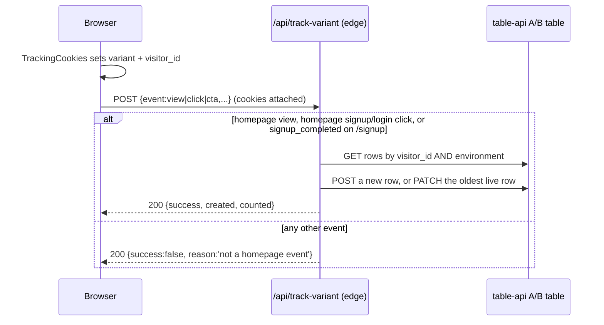

# Contracts & Data Schemas

The map of where this site's contracts are defined. The site is plain JavaScript: there are no TypeScript types or API schemas, so the field-list constants and the response paths each helper reads are the only contract, and each external service is the only authority on what it accepts. This file owns the cookie/storage keys, the analytics events, auth assumptions and missing capabilities; per-system endpoint detail lives in `current-infrastructure/`. Env var setup: [DEVELOPMENT.md](DEVELOPMENT.md); module layout: [ARCHITECTURE.md](ARCHITECTURE.md); the journeys that use these calls: [FLOWS.md](FLOWS.md).

> [!WARNING]
> The table-api keys are `NEXT_PUBLIC_*` and ship to the browser. Never add a secret with that prefix; see [13-security.md](13-security.md).

## Authoritative Type Definitions

| Domain Entity | Primary TS Type / Interface | Source File | Description |
|---|---|---|---|
| Content table ids | one constant per table (`FOOTER`, `NAVBAR`, `ABTESTCOUNT`, ...) | `src/const/tables.js` | Add new tables here; catalog in [database/entities.md](database/entities.md) |
| Content table columns | `*_FIELDS` arrays | `src/const/fields.js` | Passed as `fields=`; reference them, do not copy them into docs |
| Content fetchers | `getFooterData`, `getNavbarData`, ... (30 wrappers) | `src/utils/getData.js` | `getDataFromTable(TABLE, handleFieldsFilter(fields, filter), pageUrl)` → `data.data.rows` |
| Visitor-tracking row (written) | `toRowFields` | `src/utils/abTestVisitor.js:toRowFields` | Real column names, including the misspelt `varient` |
| Visitor-tracking row (read) | `ABTEST_ROW_FIELDS` | `src/utils/axiosCalls.js:ABTEST_ROW_FIELDS` | Read by `getAbTestVisitorRows` |
| Visitor profile (JSON in `name`) | `readProfile`, `newProfile`, `PROFILE_VERSION` | `src/utils/abTestVisitor.js` | Versioned JSON; shape in [database/entities.md](database/entities.md#entity-abtestcount-visitor-tracking-row) |
| Browser fingerprint sent with events | `collectUserInfo` | `src/utils/collectUserInfo.js:collectUserInfo` | `device`, `screen`, `browser` objects |
| Tracking cookie names and lifetimes | `VARIANT_COOKIE`, `VISITOR_ID_COOKIE`, `VARIANTS`, max ages | `src/const/abTest.js` | Used by `TrackingCookies` and the API route |

## Backend API Endpoints & Contracts

### External systems

| System | Base / env var | Auth | Endpoints, payloads, callers, degradation |
|---|---|---|---|
| table-api.viasocket.com (content, blog, A/B DBs) | `NEXT_PUBLIC_DB_BASE_URL` | `auth-key` header | [current-infrastructure/table-api.md](current-infrastructure/table-api.md) |
| Plug service (apps, combos, templates, Reddit relay) | `NEXT_PUBLIC_INTEGRATION_URL` (trailing `/`) | none | [current-infrastructure/plug-service.md](current-infrastructure/plug-service.md) |
| flow.sokt.io webhooks (forms, errors, AI answer) | hardcoded script ids | none | [current-infrastructure/flow-webhooks.md](current-infrastructure/flow-webhooks.md) |
| Cloudflare Pages + zone | dashboard | n/a | [current-infrastructure/cloudflare.md](current-infrastructure/cloudflare.md) |
| MSG91, ipapi.co, gtwy, tags, blog RSS, docstar, cal.id, Stripe links | mostly hardcoded | none | [current-infrastructure/third-party-services.md](current-infrastructure/third-party-services.md) |

Rules for every new call: table-api calls go through `src/utils/axiosCalls.js` with the table id in `src/const/tables.js`; base URLs, database ids and keys come from env vars ([DEVELOPMENT.md](DEVELOPMENT.md)), which current code does not fully follow; helpers never throw to the page.

### Data model
Table ids, purposes, fields, getters and the A/B row columns: [database/entities.md](database/entities.md).

### Internal API routes
The site serves one API route, `POST /api/track-variant` (edge; visitor-tracking upsert keyed by the `visitor_id` and `variant` cookies, always HTTP 200, currently answers `{ success: false, reason: 'lookup failed' }`). Full contract and the `/robots.txt` and `/sitemap.xml` handlers: [api/track-variant.md](api/track-variant.md).

## Authentication & Authorization Assumptions

- **No user session in this site.** Login and signup belong to the viaSocket app. The only signal is whether a `prod` cookie exists: `src/app/lib/getAuth.js:getHasToken` and `src/app/components/navbar/NavbarServer.js` turn it into `hasToken`, which swaps "Sign up" for "Dashboard". The site never reads its value, and nothing in this repo sets it.
- **Signup widget (MSG91 proxy auth).** `CustomLoginOptimized` calls `window.initVerification({ referenceId: NEXT_PUBLIC_REFERENCE_ID, state: setUtmSource(), theme, addInfo: { redirect_path } })`. The `state` string carries every key in the `utmData` cookie (UTM params, `prompt`, `intent`) to signup. `/login` is a redirect to `https://flow.viasocket.com/` in `next.config.js`. Loading and failure behaviour: [third-party-services.md](current-infrastructure/third-party-services.md).
- **Service auth** is a static `auth-key` header on table-api calls. No token refresh, no tenant header, no retry. The plug service and flow webhooks are called with no auth.

## Standard Error Envelope

There is none, on either side. Helpers catch everything and return fallbacks (`[]`, `{}`, `null`, `undefined`); `POST /api/track-variant` always answers 200 with `success: false` and an optional `reason`. Failures are reported by `src/utils/SendErrorMessage.js:sendErrorMessage` (`error`, `url`, `source`, `statusCode`; production only, [flow-webhooks.md](current-infrastructure/flow-webhooks.md)). The table API's own error body is not visible in the repo. Policy: [18-error-handling.md](18-error-handling.md).

## Persistence & Client Cache Contracts

### Cookies

| Store Name | Storage Key | Format | Owner / Invalidator |
|---|---|---|---|
| cookie | `utmData` | JSON (unencoded): `utm_*`, `affiliate_*`, `ref`, plus `utm_source`, `prompt`, `intent`. 1 day, `path=/`, `domain=.viasocket.com` on viasocket hosts. | Written by `src/utils/handleUtmSource.js` (`getUtmSource` on first load, `setUtmSource`, `savePageUtmSource`), `src/utils/userIntentTracker.js:setIntent`, `carryPromptToSignup` in `src/app/front-page/signup.js`, `src/components/IntegrationsComp/integrationsAppOneComp/popularUseCases.js`. Read by `setUtmSource` (signup `state`) and `savePageUtmSource`. |
| cookie | `variant` (`VARIANT_COOKIE`) | `A` or `B`; 30 days; `samesite=lax` | Written by `src/app/components/VariantTracker/TrackingCookies.js` (inline script before paint). Read by `src/utils/getVariant.js:getVariant`, `POST /api/track-variant`. |
| cookie | `visitor_id` (`VISITOR_ID_COOKIE`) | UUID; 1 year; `.viasocket.com`, so shared by test and production | Written by `TrackingCookies` (new UUID, or restored from `vs_visitor`); repaired by `src/utils/trackVisitor.js`. Read by `POST /api/track-variant`. |
| cookie | `rdt_cid` | Reddit click id; 30 days; `secure`, `sameSite=lax` | `src/middleware.js` sets it from a valid `?rdt_cid=` and deletes it when an invalid one arrives; read for the Reddit CAPI call. |
| cookie | `prod` | presence only | Set outside this repo; read by `getHasToken`, `NavbarServer`. |

Rules for `utmData`: `utm_source` is the page path (`/integrations`) or a registered tag in `INTERNAL_UTM_SOURCES` (`home-A`, `home-B`, `relay-switch-google-ads`). `savePageUtmSource` overwrites only a source that `isInternalUtmSource` accepts, so external attribution survives. A prompt goes in `utmData.prompt` before calling `savePageUtmSource`, never in the URL. Cookies are written from the browser because Cloudflare strips `Set-Cookie` from cached HTML ([cloudflare.md](current-infrastructure/cloudflare.md)).

### localStorage

| Store Name | Storage Key | Format | Owner / Invalidator |
|---|---|---|---|
| `localStorage` | `vs_session` | `{ id, at }`; a visit ends after 30 min idle | `src/utils/trackVisitor.js` |
| `localStorage` | `vs_visitor` | JSON string copy of `visitor_id` | `src/utils/trackVisitor.js`; read by `TrackingCookies` |
| `localStorage` | `prompt` | best-effort copy of the hero prompt | `carryPromptToSignup` in `src/app/front-page/signup.js` |
| `localStorage` | `copiedTemplateIds` | JSON array of template ids | `src/utils/templateIdManager.js`, `src/hooks/useTemplateIds.js` |
| `localStorage` | `viasocket_chat_thread` | `{ id, createdAt }`; reused for 1 h | `src/app/providers.js`, `public/new-home/assets/support.js` |
| `localStorage` | `vs-doc-lang` | chosen code-sample language | `src/app/developers/docs/LangContext.js` |
| `localStorage` | `vs_variant` | `A` or `B` | `public/home-ab.js` and `TrackingCookies`. Restores the `variant` cookie after its 30 days |
| `localStorage` | `mw_visitor` | 32 hex chars; one browser, until storage is cleared | `src/utils/mwExperiment.js`. Not the `visitor_id` cookie, and not shared with test vs production by a domain. |

No `sessionStorage` keys. Every `trackVisitor` and `mwExperiment` storage access is wrapped in try/catch; follow that.

### Server-side caches
`axiosWithCache` in `src/utils/axiosCalls.js` is an in-memory TTL cache per server instance with no invalidation hook (TTLs per helper in [table-api.md](current-infrastructure/table-api.md)); the production Cloudflare zone cache is a separate layer. All caching layers: [14-performance.md](14-performance.md).

## Analytics & Telemetry Event Contracts

### First-party visitor tracking



| Event Name | Trigger Location | Required Payload Properties |
|---|---|---|
| `view` | homepage: `public/home-ab.js` when `/` or `/home-b` is shown. Other pages: `VariantTracker` still posts, and the route drops them | common fields + `userInfo`, `sessionId`, `isNewSession` |
| `click` | any click inside an element with `data-track` (one capture listener) → `src/utils/trackVisitor.js:trackInteraction` | common fields + `element` = `data-track`, `label` = `data-track-label` or text, `section` = `data-track-section` or `other`, `action` = `data-track-action` or `click`, `destinationUrl` = `data-track-destination` or nearest `href` |
| `cta` | hero CTAs: `src/app/components/home/CTAButtons.js`, `trackSignupClick` in `src/app/front-page/signup.js` → `src/utils/trackVisitor.js:trackCtaClick` | common fields + `ctaSource` (the utm tag), `section: 'hero'`, `element`, `label`, `action` (`signup_click` / `dashboard_click`), `destinationUrl` |

Common fields: `pageUrl`, `utmData` (the `utm_*` params on the current URL, not the cookie), `referrer`. To instrument a new CTA, add `data-track="<section>_<thing>"` (lowercase, underscores) rather than new code. Per-button detail goes in `element` / `label`, never in `utm_source`. Tracking must run in all three environments; do not gate it on production. Server-side validation and response shapes: [api/track-variant.md](api/track-variant.md).

`setIntent(value)` in `src/utils/userIntentTracker.js` is not an event: it stores `intent` in `utmData` (only caller: `src/app/hire-an-expert/HireExpertClient.js`, value `hireanexpert`) so signup receives it in `state`.

The static homepage (`public/new-home/`) is outside the Next.js layout, so it gets no `TrackingCookies`, `VariantTracker`, Zaraz or Reddit pixel. Only GTM is in its HTML.

### Middleware experiments

`src/utils/mwExperiment.js` is the only copy of the middleware experiment client. It does not run an experiment, and no page calls it yet. It is separate from the visitor table above: a different id (`mw_visitor`), a different endpoint, and no read of the `variant` cookie. The owner defines and starts experiments in the middleware. Until one is running, that host refuses the events.

| | |
|---|---|
| Endpoint | `POST https://cursor-slack-bot.embarko.app/repos/viasocket/events` |
| Auth | JSON field `key`: the publishable `MW_KEY` in that file. It can only append. It is not a table-api key. |
| Body | `{ key, visitor_id, event, experiment, variant, goal? }` |
| `event` | `exposure` when the variant is shown. `conversion` when the goal happens, with `goal` (for example `signup`). |
| Transport | `navigator.sendBeacon` with the JSON string, else `fetch` (`keepalive`, `credentials: 'omit'`, 3 s timeout). The caller does not await it, retry it, or read the response. After one failure, later sends in that page are dropped. |

Assignment is local. `mwVariant(experiment, variants)` hashes `experiment:visitor_id` (FNV-1a, then the finalizer in the file) and walks `variants` in order (`[['control', 50], ['b', 50]]`). The weights are the second column. On any error, including a call during server render, it returns the first variant.

A page uses it from a client component. `/developers` has no `@/` imports, so a file there imports this module by relative path.

```javascript
import { mwSend, mwVariant } from '@/utils/mwExperiment';

const VARIANTS = [['control', 50], ['b', 50]];
const variant = mwVariant('hero-cta', VARIANTS); // during render, not after a fetch
mwSend({ event: 'exposure', experiment: 'hero-cta', variant }); // when it is shown, not inside render
mwSend({ event: 'conversion', experiment: 'hero-cta', variant, goal: 'signup' }); // on the goal action
```

`mwVariant` during a server render returns the control, because the server cannot see `localStorage`. Rendering different markup from that return value in a server-rendered component will not match the browser. Keep the server HTML the same, and send the exposure from the browser after the variant is on screen. `/` does not load this module: `public/new-home/` is exported from `viasocket-site` and never runs `src/`. An experiment on the homepage belongs in that export, as a second copy only if the homepage must run one.

### Third-party tags

| Tag | Loaded in | Events / ids | Environments |
|---|---|---|---|
| Google Tag Manager `GTM-THTCRSLN` | `src/components/headComp/headComp.js` (via `src/app/providers.js`), noscript in `src/app/layout.js`, `public/new-home/index.html` | container-defined | all |
| Google Ads `AW-16852796533` | `src/app/lifetime-deal/page.js`, `src/app/migration/*/page.js`; `gtag_report_conversion` in `headComp` | `conversion` on `src/app/lifetime-deal/success/page.js` and the migration pages; `gtag_report_conversion` has no caller | all |
| Reddit pixel | `src/app/components/RedditPixel/RedditPixel.js` | `rdt('init', NEXT_PUBLIC_REDDIT_PIXEL_ID)`, `PageVisit` | production only |
| Reddit Conversions API | `src/middleware.js` via plug service `api/reddit/page-visit` | every matched page request, with `click_id` from `rdt_cid` | production only |
| X (Twitter) pixel | `headComp` (`twq('config', ...)`), event in `src/components/mcpComps/mcpIndexComp/McpIndexComp.js` | one conversion event | all |
| Cloudflare Zaraz | `loadZarazManually` in `src/app/providers.js` (`/cdn-cgi/zaraz/i.js`) | configured in Cloudflare | Cloudflare-served only |
| cr-relay `signals` | inline script in `src/app/layout.js` | `window.signals.identify({ email })` from `integrationsRequestComp.js` | all |
| Amplify tracker script | `src/app/page.js`, `src/app/home/page.js`, `src/app/front-page/IndexPageContent.js` (not rendered at `/`) | unknown | all |

### Outbound links that carry parameters

| Destination | Built by | Parameters |
|---|---|---|
| `${NEXT_PUBLIC_FLOW_URL}/makeflow/trigger/<triggerId>/action?events=<ids>...` and `/connect/<rowid>` | integrations components (`src/components/IntegrationsComp/**`) | plug service row ids |
| `https://flow.viasocket.com/...` from `/` and `/home-b` | `public/home-ab.js` stamps every such link before the visitor can use it | `hp_variant=A` or `hp_variant=B` (the homepage version). Not a `utm_source` |
| an app's own website | `src/utils/ExternalLink.jsx:appWebsiteUrl` (single-app page "Learn more"); `src/components/IntegrationsComp/integrationsAppTwoComp/AboutApps.js` (app pairs) appends the same tag inline | forced to `https://`, `utm_source=viasocket` appended (outbound referral tag, not a signup source); magicalapi.com gets `/integrations/viasocket/`. `rel` from `relForApp`: dofollow only for apps in the `DOFOLLOWLINK` table |
| `/signup` | `src/app/components/home/CTAButtons.js`, `src/app/front-page/signup.js` | `utm_source=<tag>` exactly once; no `prompt` |
| any URL via `src/utils/handleRedirection.js:handleRedirect` | CTAs to `flow.viasocket.com` and others | `state=<utmData JSON>&<utm pairs>`; with `customSource`, `state={"utm_source":...}&utm_source=...` (emitted twice, so pages with their own tag link straight to `/signup?utm_source=`) |

## Published Contracts (developer docs page)

`src/app/developers/docs/page.js` documents the Embed / Apps API for external developers. The site does not call these. Copy there is a public contract that must match the platform:
- Base URLs `https://flow-api.viasocket.com` (API) and `https://flow.sokt.io/func/<script_id>` (run an action); `https://beta-flow.viasocket.com/documentation/<service_id>?format=http` for app reference.
- Every call sends `authorization: <embed token>`, an HS256 JWT over `{ org_id, project_id, unique_identifier }` signed with `VIASOCKET_EMBED_SECRET` on the developer's server.
- Endpoints shown: app search (GET flow webhook `?key=`), `POST /embed/enable/<service_id>/<auth_id>`, `POST /embed/list-options/<action_id>`, run action (POST flow webhook with `inputData`).
- The Express routes in its samples (`/api/integrations/search`, `/api/integrations/connected`, `/api/integrations/options`, `/api/integrations/run`) are example code for the reader's backend, not routes of this site.

## Required / Unavailable Backend Capabilities

No proposed endpoints. Known gaps a change may run into:
- **Delete on the table API** does not exist. Anything that writes test rows must tag them (`environment`) and live with them.
- **Server-side reCAPTCHA verification** does not exist; no form uses reCAPTCHA. The unimported provider and `react-google-recaptcha-v3` were removed on 2026-10-21, and the site-key env var in `.env` is now unread ([DEVELOPMENT.md](DEVELOPMENT.md)). If a form needs bot protection, design a server route using a key without the `NEXT_PUBLIC_*` prefix; do not ship a client-only check.
- **Storing the homepage version on accounts this site cannot see.** `/signup` records a completed registration it observes (a 2xx POST to a URL containing `/c/register` whose body is not `hasError`) as `signup_completed`, with the `variant` cookie, so those signups per version are readable from the A/B table. Homepage Start free and Log in go to flow.viasocket.com and never hit `/signup`. Google, Apple, and any path that leaves `/signup` before that response also finish elsewhere. Both homepages add `hp_variant=A` or `hp_variant=B` to every `flow.viasocket.com` link, and the `variant` cookie (same values, not HttpOnly, domain `.viasocket.com`) is readable there. The signup app must read `hp_variant` from the arrival URL, or the `variant` cookie when the query param is absent, and store that value on the new account. Until it does, signups that never produce a `/c/register` response on `/signup` cannot be counted from this repo. The paired backend is [socket-flow-backend](https://github.com/Walkover-Web-Solution/socket-flow-backend).
