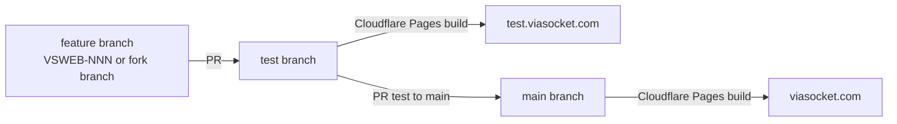

# Development & Verification Guide

How to install, run, build and verify this repo, which environment variables it reads, and how a change moves from a branch to viasocket.com. The repo has no tests, lint or typecheck, so the [verification checklist](#how-an-agent-checks-its-work-verification-checklist) below is how you prove a change works; the criteria a finished change must meet are in [22-definition-of-done](22-definition-of-done.md). This file is also the single home for environment setup, deployment and git workflow (there is no separate 15/19/20/23 guide).

## Prerequisites & Runtime Environment

- **Node.js:** no `.nvmrc`, `.node-version` or `engines` field exists. The baseline was verified with Node v22.15.0 and npm 10.9.2. <!-- verify:ignore -->
- **Package manager:** npm (`package-lock.json`, lockfileVersion 3). No other lockfile.
- **`.npmrc`:** contains only `legacy-peer-deps=true`. Every `npm install`/`npm ci` skips peer-dependency conflict errors, so a peer mismatch shows up at build or run time, not at install time. Do not delete this line: install can start failing.
- **Language:** plain JavaScript. `jsconfig.json` maps `@/*` to `src/*`. There is no `tsconfig.json`; the only TypeScript file is the generated `next-env.d.ts`. Versions of everything are in [06-tech-stack](06-tech-stack.md). <!-- verify:ignore -->
- **System tools:** git. `wrangler` (devDependency) is only needed for `preview`/`deploy`.

## Step-by-Step Setup

1. **Install**
   ```bash
   npm install        # or: npm ci  (both honour .npmrc legacy-peer-deps)
   ```
2. **Environment**: there is **no `.env.example`**. Get a `.env` from a teammate. It is gitignored, as are `.env*.local` files. Next loads `.env` at dev and build time (the baseline build log shows `Environments: .env`). The variables are listed in the [reference table](#environment-variables-reference). Never commit `.env` or paste its values into docs, PRs or chat. <!-- verify:ignore -->
   > [!TODO]
   > Decide whether to add a tracked `.env.example` with names only. Until then this table is the only list. <!-- verify:ignore -->
3. **Dev server**
   ```bash
   npm run dev        # next dev -p 1111
   ```
   Open http://localhost:1111. The server is ready in about 1.3 s, but the first request to each route compiles it, which takes tens of seconds. Wait for the first request; a slow first response is not an error. `.claude/launch.json` defines the same command as `viasocket-dev` (port 1111).

## Scripts (`package.json`)

| Script | Command | Notes |
|---|---|---|
| `dev` | `next dev -p 1111` | Local dev on port **1111**, not 3000. Verified. |
| `prebuild` | `node build-utilities/generate-robots-txt.js` | Runs automatically before `build`. **Writes an untracked `public/robots.txt`.** Delete it after a local build so it is not committed. See [robots footgun](#footguns). <!-- verify:ignore --> |
| `build` | `next build` | Verified at baseline: exit 0, "Compiled with warnings". The warnings are Sass `@import` deprecations from `src/scss/_import.scss` and `src/scss/global.scss`, and they are expected. |
| `start` | `next start -p 1111` | Serves a local `next build`. Not verified in this pass. |
| `pages:build` | `npx @cloudflare/next-on-pages` | The Cloudflare adapter. It runs `vercel build` internally, which runs `npm run build` and therefore `prebuild`, and writes `.vercel/output/`. Not run in this pass. |
| `preview` | `npm run pages:build && wrangler pages dev` | Runs the Cloudflare Pages build locally in workerd. Closest to production, and slow. Not run in this pass. |
| `deploy` | `npm run pages:build && wrangler pages deploy` | Manual deploy from a laptop. **This is not the normal release path** (see [PR & deployment](#pr-workflow--deployment-pipeline)). Do not run it. |

> [!TODO]
> `wrangler.toml` contains only `compatibility_flags = ["nodejs_compat"]`, with no `name` and no `pages_build_output_dir`, so `wrangler pages deploy` with no arguments would need a project and directory supplied interactively. Confirm whether `npm run deploy` is ever used, or whether releases happen only through the Cloudflare Pages git integration. If it is never used, the script could be removed (decision for the team). <!-- verify:ignore -->

## Environment Variables Reference

These are all the `process.env.*` reads in `src/`, `build-utilities/` and `next.config.js` at 17b99cd8. `next.config.js` and `src/middleware.js` read nothing beyond what is listed. Values are deliberately omitted.

**Client-exposed** means the name starts with `NEXT_PUBLIC_`. Next inlines it as a literal into any client bundle that references it. `src/utils/axiosCalls.js` is imported by `'use client'` files (`src/app/components/home/SearchInputHomeOptimized.js`, `src/app/components/integrations-script/TemplatePreview.js`, `src/components/indexComps/CategoryAppsDisplay.js`). Treat every `NEXT_PUBLIC_*` value, including the table-api `auth-key`s, as public. <!-- verify:ignore -->

| Variable | Required | Client-exposed | Default in code | Where read / purpose |
|---|---|---|---|---|
| `NEXT_PUBLIC_PRODUCTION_ENVIRONMENT` | Yes | Yes | none (unset counts as not prod) | Environment switch, see [Environments](#environments). Read in `src/app/layout.js` (noindex), `src/app/robots.txt/route.js`, `build-utilities/generate-robots-txt.js`, `src/middleware.js` (Reddit CAPI), `src/app/components/RedditPixel/RedditPixel.js`, `src/utils/SendErrorMessage.js`, `src/utils/axiosCalls.js:trackRedditEvent`, `src/app/api/track-variant/route.js` (row `environment`), and `src/components/IntegrationsComp/IntegrationsBetaComp/integrationsRequestComp.js` (sent as `environment`). |
| `NEXT_PUBLIC_BASE_URL` | Yes | Yes | `https://viasocket.com` only in `src/app/lib/data.js:getHomePageData` | Site origin with **no trailing slash**. Code appends paths to it (`src/utils/createURL.js`, about 30 `src/app/lib/*-data.js` page URLs used for canonical/meta and error reports). |
| `NEXT_PUBLIC_DB_BASE_URL` | Yes | Yes | none | table-api base URL. The DB ids are hard-coded after it in `src/utils/axiosCalls.js:getDataFromTable` and its siblings. API shapes are in [CONTRACTS](CONTRACTS.md). |
| `NEXT_PUBLIC_DB_KEY` | Yes | Yes | none | `auth-key` header for the content tables (`getDataFromTable`, `getMeta`, `getFaq`, `getIndustries`, ...). |
| `NEXT_PUBLIC_DB_KEY_ABTEST` | Yes for A/B tracking | Yes | none | `auth-key` for the A/B visitor table (`src/utils/axiosCalls.js:abTestHeaders`), used by `/api/track-variant`. |
| `NEXT_PUBLIC_BLOG_DB_KEY` | Yes for blog lists | Yes | none | `auth-key` for `src/utils/axiosCalls.js:getBlogs` (the blog table URL itself is hard-coded). |
| `NEXT_PUBLIC_INTEGRATION_URL` | Yes | Yes | none | Plug-service base URL. **Must end with `/`**, because code builds `${URL}plugins/search`, `${URL}templates/all` and `${URL}api/reddit/...` (`src/utils/searchApps.js`, `src/utils/axiosCalls.js`, `src/middleware.js`, `src/app/components/workflow-automation-ideas/AutomationSuggestionsClient.js`). |
| `NEXT_PUBLIC_FLOW_URL` | Yes | Yes | none | Flow app base URL with **no trailing slash** (`${URL}/makeflow/...`). Used for "use this flow" links in `src/components/IntegrationsComp/**` and `AutomationSuggestionsClient.js`. |
| `NEXT_PUBLIC_REFERENCE_ID` | Yes for login widget | Yes | none | Login-widget reference id and DOM id in `src/app/components/customLogin/CustomLoginOptimized.js`. |
| `NEXT_PUBLIC_REDDIT_PIXEL_ID` | Prod only | Yes | none | Reddit pixel init. The pixel renders only when the environment is `prod` (`RedditPixel.js`). |
| `HOSTNAME` | No | No (build-time) | `''` | Read only by `build-utilities/generate-robots-txt.js`. A host containing `integrate` or `integration` forces the disallow-all robots file. |
| `VERCEL_URL` | No | No (build-time) | `''` | Fallback for `HOSTNAME` in the same script. Set by `vercel build` (run by `pages:build`), so it is not a leftover. |

`VIASOCKET_ORG_ID`, `VIASOCKET_PROJECT_ID` and `VIASOCKET_EMBED_SECRET` appear in `src/app/developers/docs/page.js` only inside **code-sample strings** shown to customers. The site never reads them. Do not add them to `.env`.

**Mismatches between `.env` and code** (names only):

- **In `.env` but never read by code:** `NEXT_PUBLIC_PROD_ENVIRONMENT` (the code reads only `NEXT_PUBLIC_PRODUCTION_ENVIRONMENT`), `NEXT_PUBLIC_BLOG_DB_URL` (last referenced in 2025-02; the blog URL is now hard-coded), `NEXT_PUBLIC_DB_ID` (removed in 6d3df50b "Correct id"; DB ids are hard-coded), `NEXT_PUBLIC_DB_ID_AZ`, `NEXT_PUBLIC_DB_KEY_AZ`, `PAUTH_KEY`, `NEXT_PUBLIC_RECAPTCHA_KEY` (its only reader, an unimported reCAPTCHA provider, was removed 2026-10-21), `SERVER_RECAPTCHA_KEY` (last referenced 2026-01, before f5d90daa "page to app"), `USECASE_CREATE`, `USECASE_UPDATE`. Also, `NEXT_PUBLIC_BLOG_DB_KEY` is defined **twice** in the local `.env`, and the later definition wins. <!-- verify:ignore -->
- **Read by code but not in `.env`:** `HOSTNAME`, `VERCEL_URL`. Both are build-time and platform-provided.

> [!TODO]
> The Cloudflare Pages dashboard holds the real per-environment values for test and production, and they are not in the repo. Confirm that each `NEXT_PUBLIC_*` above is set for both the `test` and `main` deployments. Next inlines `NEXT_PUBLIC_*` at **build** time, so changing one requires a rebuild or redeploy.

### Environments

All three environments run the same code. `NEXT_PUBLIC_PRODUCTION_ENVIRONMENT` is the only switch.

| Environment | Host | Flag value | Effect |
|---|---|---|---|
| local | http://localhost:1111 | anything other than `prod` | noindex meta, `Disallow: /` robots, no Reddit pixel or CAPI, `sendErrorMessage` only logs |
| test | test.viasocket.com <!-- verify:ignore --> | not `prod` | Same as local. Verified 2026-10-21: robots returns `Disallow: /`. |
| production | viasocket.com <!-- verify:ignore --> | `prod` | indexable, robots with two `Sitemap:` lines, Reddit pixel and CAPI on, error reports POSTed to flow.sokt.io <!-- verify:ignore --> |

> [!WARNING]
> Only the exact string `prod` switches on production behaviour in `layout.js`, both robots generators, `RedditPixel`, `SendErrorMessage` and `trackRedditEvent`. `src/app/api/track-variant/route.js:getEnvironment` is more lenient. It maps `prod`/`production` to `production`, `test`/`stage`/`staging` to `test`, and `local`/`dev`/`development` to `local`, and falls back to the hostname when the flag is unset. A value like `production` would therefore tag A/B rows as production while leaving the site noindexed. Use `prod` for production.

`NEXT_PUBLIC_PROD_ENVIRONMENT` is **not** a second switch: nothing reads it. <!-- verify:ignore -->

The static homepage in `public/new-home/` reads no env vars and hard-codes absolute URLs such as https://viasocket.com and https://flow.viasocket.com, so it looks the same in every environment. <!-- verify:ignore -->

## Build & Preview Verification

```bash
npm run build          # prebuild (writes public/robots.txt) + next build; must exit 0
rm -f public/robots.txt   # it is untracked build output; never commit it
npm run start          # optional: serve the build on :1111
npm run preview        # optional, slow: real Cloudflare Pages build in workerd
```

A passing `next build` lists **53 routes: 50 dynamic (`ƒ`)**, including `/use-cases` and `/new-direction` added in `b3a7ab32`, **plus 3 static (`○`)**: `/agency-partner/success`, `/lifetime-deal/success` and `/_not-found`. The full route table is in [05-navigation](05-navigation.md). Shared First Load JS was 102 kB at baseline. The Sass deprecation warnings are pre-existing; any **new** warning or error is yours. <!-- verify:ignore -->

## Running Automated Checks & Tests

| Check | Command | Status |
|---|---|---|
| Type checking | none | Plain JS, no `tsconfig.json`, no typecheck script. <!-- verify:ignore --> |
| Linting | none | No ESLint config or `lint` script. |
| Formatting | No script. `npx prettier --check <file>` shows whether a file already matches; never `--write` a file that doesn't, because it reformats lines you didn't touch (see the warning below) | `.prettierrc`: 4-space indent, single quotes, `printWidth` 120, `trailingComma` es5, `semi`, `quoteProps` preserve. `.prettierignore` covers build/coverage/`/node_modules`/`/.next/`/`/out/`. |
| Pre-commit hooks | none active | `husky` and `lint-staged` are devDependencies only. There is no `.husky/` directory, no `lint-staged` config, no `prepare` script, and no `core.hooksPath`. <!-- verify:ignore --> |
| Unit / E2E tests | none | No test runner or test files. |
| CI | none in repo | No `.github/workflows/` or other CI config. Builds run in Cloudflare Pages. <!-- verify:ignore --> |

> [!WARNING]
> **Never run Prettier, or any formatter, over the whole repo or over files you did not otherwise change.** About half of the code does not match `.prettierrc` (221 of 471 `src` JS files reported by `prettier --list-different` on 2026-10-21). A past session ran Prettier across 43 files during an unrelated change, and the human reverted all of it. Format only the lines you touch. If a file's existing style differs from Prettier, match the file's style.

## Safe Test-Data Guidance

- **There are no mocks, fixtures or sandbox users.** Local and test read **live production content tables** on table-api and plug-service. Reading is safe; there is no separate dev database.
- **Writes are real.** `/api/track-variant` (`saveAbTestVisit`, `updateAbTestVisit` in `src/utils/axiosCalls.js`) and the integration-request form write to live tables from **every** environment, including local.
- **table-api has no DELETE.** It supports GET, POST and PATCH only, so rows written while testing **cannot be removed**. Keep test writes few, and make sure each row carries an `environment` value (`local` or `test`) so it can be told apart from real data. Any code that reads rows back must filter on the current environment, because test and production share the `visitor_id` cookie on the whole `.viasocket.com` domain. <!-- verify:ignore -->
- **table-api reads are cached.** Reads return a long `cache-control` max-age, and `src/utils/axiosCalls.js` adds a 20-minute in-process cache. When reading a row back by hand, add a unique cache-busting query parameter, or a stale copy will look like a lost write.
- **Column names are the schema authority.** Examples: the A/B visitor column is spelled `varient`, and `first_url`/`last_url` are linked-record columns that reject plain URLs. Only a real write shows you what table-api accepts. See [CONTRACTS](CONTRACTS.md).

## How an Agent Checks Its Work (Verification Checklist)

This is the procedure. What "done" means is in [22-definition-of-done](22-definition-of-done.md); work through these steps until every item there holds.

1. **Baseline first.** Note `git status` and the branch you are on. Stay on it: do not create or switch branches (human rule). Read existing behaviour before editing. For tracking bugs, prove which layer fails (cookie, then API request, then payload, then response, then a fresh cache-busted read) before changing code.
2. **Build.** `npm run build` exits 0 with no new warnings. Then `rm -f public/robots.txt`.
3. **HTTP-check the routes you affected** on `npm run dev` (port 1111). Check each route's status code, `<title>` and canonical:
   ```bash
   curl -s -o /tmp/p.html -w '%{http_code} %{redirect_url}\n' http://localhost:1111/pricing
   grep -o '<title>[^<]*' /tmp/p.html; grep -o 'rel="canonical" href="[^"]*"' /tmp/p.html
   ```
   Baseline expectations: `/` returns 200 with canonical https://viasocket.com/ (from the static `public/new-home/index.html`). `/home` returns 307 to `/` (middleware). `/embed` returns 308 to `/developers`. `/about` returns 308 to `/help/about-us`. `/help` returns 301 to `/new-direction`, while `/help/about-us` (a footer help page, served by another deployment) is a 404 locally. `/login` returns 307 to flow.viasocket.com. An unknown path returns 404 with "404 - Page not found". <!-- verify:ignore -->
4. **SEO files.** `curl http://localhost:1111/robots.txt` must return `Disallow: /` locally. `/sitemap.xml` must return 200. If you touched robots logic, change **both** `src/app/robots.txt/route.js` and `build-utilities/generate-robots-txt.js`.
5. **Per-visitor, cookie or cache behaviour.** Local and test do not show it. Compare production and test headers:
   ```bash
   curl -s -D - -o /dev/null https://viasocket.com/ | grep -iE 'cache-control|cf-cache-status|vary|set-cookie'
   curl -s -D - -o /dev/null https://test.viasocket.com/ | grep -iE 'cache-control|cf-cache-status|vary|set-cookie'
   ```
   On 2026-10-21 production `/` returned `cache-control: public, max-age=10800, must-revalidate` and `cf-cache-status: HIT`, while test returned `max-age=0` and `DYNAMIC`. The production value comes from a Cloudflare zone rule that is not in the repo. Behaviour that works on test can still break on production, so check production after the deploy.
6. **Analytics and tracking.** These are not verified until you have done a real write followed by a cache-busted read of the row on the live table (see [Safe test data](#safe-test-data-guidance)). If you cannot do that, say "not verified end-to-end". Tracking must work in all three environments; do not gate it on `prod`.
7. **Diff hygiene.** Keep the change minimal and scoped. Do not reformat untouched code. Copy stays as constants in the component. Use Tailwind before custom CSS. Use env vars instead of hard-coded endpoints. Do not commit `.env` or `public/robots.txt`. <!-- verify:ignore -->
8. **Docs.** If you changed env vars, scripts, routes or flows, update the owning `docs/*.md` file and run:
   ```bash
   # with the create-ai-docs skill installed: /ai-docs check, or directly
   python3 "$SKILL_DIR/scripts/verify_docs.py" . --docs docs/DEVELOPMENT.md
   ```

## PR Workflow & Deployment Pipeline

Environments are listed in [Environments](#environments) (local, test.viasocket.com, viasocket.com). <!-- verify:ignore -->

### Pipeline

Confirmed by the human on 2026-10-21:



1. **Feature branch → PR into `test`.** After the merge, Cloudflare Pages builds and deploys test.viasocket.com. Verify there. <!-- verify:ignore -->
2. **PR from `test` into `main`.** After the merge, Cloudflare Pages builds and deploys production viasocket.com. Then check production behaviour (checklist step 5), because the production cache rule differs from test. <!-- verify:ignore -->
3. **`prod` branch:** legacy. Do not target it.

There are no CI checks in the repo. The only gate is the Cloudflare Pages build succeeding.

> [!TODO]
> Not evidenced in the repo: the Cloudflare Pages project's build command and output directory (expected `npx @cloudflare/next-on-pages` and `.vercel/output/static`), and which branches it builds. They live in the Cloudflare dashboard. Needs a human. <!-- verify:ignore -->

### Config

- Configuration is the env vars in the [reference table](#environment-variables-reference); there is no config file per environment. For test and production they are set in the Cloudflare Pages project and **injected at build time**: Next inlines `NEXT_PUBLIC_*` into the bundle, so a changed value needs a rebuild. <!-- verify:ignore -->
- `wrangler.toml` sets only `compatibility_flags = ["nodejs_compat"]`. Cache rules for production live in a Cloudflare zone rule outside the repo ([current-infrastructure/cloudflare](current-infrastructure/cloudflare.md)). <!-- verify:ignore -->

### Rollback

- **Observed path: a revert PR.** Bad changes have been undone with GitHub's "Revert" button, which opens a `revert-<pr>-<branch>` branch that is merged like any PR (e.g. #1809 `revert-1805-VSWEB-833`, #1792 `revert-1790-VSWEB-824`, #1765 `revert-1762-VSWEB-811-2`). The revert then travels the same feature → `test` → `main` path, and the next Cloudflare Pages build redeploys the previous code (inferred from the pipeline). <!-- verify:ignore -->

> [!TODO]
> Not evidenced in the repo: whether the team also uses Cloudflare Pages' "rollback to a previous deployment" in the dashboard, who may do it, and how a rolled-back deployment is reconciled with `main`. Needs a human.

### Branching

- **Agents work on the branch that is already checked out** and never create or switch branches; the human owns branching. Commit or push only when asked.
- Observed names (merge subjects of the last 200 merges): Jira-style `VSWEB-NNN` (most common, also `VSWEB-NNN-N`, `VSWEB-NNN-MAIN`), `SKTF-NNN`, fork branches such as `ankitw22/feat/<topic>` and `ui/<topic>`, and `revert-<pr>-<branch>`. About a quarter of merges are `test` → `main` release PRs. <!-- verify:ignore -->

> [!TODO]
> Not evidenced in the repo: whether new feature branches start from `test` or `main`. Needs a human.

### Commits

- No enforced convention (no commitlint, no hooks). Recent history uses a sentence-case subject naming the area first, e.g. `Integration page: beta notice for apps with no actions or triggers`, `/integrations: back to compact app cells`. Older commits mix free-form subjects, some conventional-commit prefixes, and a ` || N` suffix. Follow the recent `Area: what changed` style. <!-- verify:ignore -->
- End agent-made commits with the attribution line the session asks for.

### PRs & review

- One concern per PR, small, following [22-definition-of-done](22-definition-of-done.md). PRs are merged with GitHub merge commits (`Merge pull request #NNNN from <owner>/<branch>`). <!-- verify:ignore -->
- There is no PR template and no `CODEOWNERS` in the repo. <!-- verify:ignore -->

> [!TODO]
> Not evidenced in the repo: whether PRs need reviewer approval or branch protection on `test` and `main`. Needs a human.

### Deployment adapter: Cloudflare next-on-pages

- Hosting is **Cloudflare Pages** for both test and production, through `@cloudflare/next-on-pages`. `vercel` is a **peerDependency** of that adapter, because it runs `vercel build`, and `.vercel/output/` is its build output (gitignored). So the `vercel` devDependency is **in use**, not leftover, even though no Vercel hosting is involved.
- **Every dynamic page and route exports `export const runtime = 'edge'`** (50 files). next-on-pages requires this. Only layouts and the static `/agency-partner/success` and `/lifetime-deal/success` pages omit it. A new dynamic route without it will fail the Cloudflare build even though `next build` passes. Node-only APIs (`fs`, etc.) are unavailable at runtime, and `next.config.js` stubs `fs` with `resolve.fallback`.
- **Migrating to OpenNext was tried and reverted.** bf40a045 "debug" (2026-01-07) switched to `@opennextjs/cloudflare` and Next 16. Fifteen minutes later 90e5fc7b "revert to next 15" restored next-on-pages and Next 15/React 18. It left `open-next.config.ts` behind (importing the uninstalled `@opennextjs/cloudflare`); that orphan was removed on 2026-10-21. <!-- verify:ignore --> Treat a future migration as its own explicitly scoped project, never as part of a bug fix (see [DECISIONS](DECISIONS.md)).

## Footguns

> [!WARNING]
> **Two robots.txt generators.** `src/app/robots.txt/route.js` (edge route, decides at request time) and `build-utilities/generate-robots-txt.js` (prebuild, writes `public/robots.txt` at build time) contain the same logic. Locally the route answers. On production, robots.txt returned `content-type: text/plain` with no charset, which matches the route's header, but which file wins on Cloudflare Pages is unconfirmed (see [OPEN_QUESTIONS](OPEN_QUESTIONS.md)). Keep both in sync. <!-- verify:ignore -->

> [!WARNING]
> **`NEXT_PUBLIC_*` values are baked in at build time.** Changing one in the Cloudflare dashboard has no effect until the next build. These values are also shipped to browsers, so never put a real secret behind a `NEXT_PUBLIC_` name. <!-- verify:ignore -->

> [!WARNING]
> **URL joining is slash-sensitive.** `NEXT_PUBLIC_INTEGRATION_URL` must end in `/`. `NEXT_PUBLIC_BASE_URL` and `NEXT_PUBLIC_FLOW_URL` must not end in `/`.
