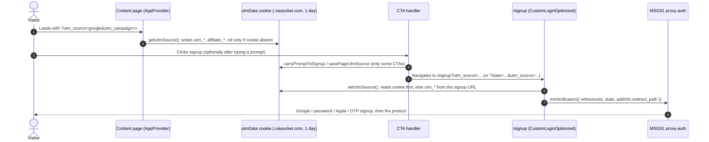

# User Flows & Critical Journeys

viaSocket's site is a marketing site: there is no logged-in area here. Every journey ends by handing the visitor to somewhere else: the MSG91 signup widget on `/signup`, the product at flow.viasocket.com, a cal.id booking, Stripe, or a flow.sokt.io webhook that receives a form. What this repo owns is **attribution**: making sure the right `utm_source` (and any typed prompt) reaches signup. It also owns the **content pages** that bring visitors in. This doc traces those paths and the ways they fail. Module layout lives in [ARCHITECTURE.md](ARCHITECTURE.md), endpoint and payload shapes in [CONTRACTS.md](CONTRACTS.md), and env vars in [DEVELOPMENT.md](DEVELOPMENT.md).

## Cross-cutting navigation facts

These apply to every journey below. Agents get them wrong most often.

- **`/` is not a Next page.** `next.config.js` has a `beforeFiles` rewrite from `/` to `public/new-home/index.html`, which is plain HTML plus `public/new-home/main.js`. The root layout, `src/app/providers.js:AppProvider`, `TrackingCookies`, `VariantTracker` and `RedditPixel` therefore **do not run on the homepage**. Only `src/middleware.js` runs there. `src/app/page.js:HomePage`, with its A/B variants, is built but unreachable at `/`.
- **Internal links are full page loads.** `AppProvider` installs a document click listener. Any same-origin `<a>` click (not `#` links and not `target="_blank"`) has its default prevented, a skeleton is shown, and the code sets `window.location.href`. Client-side `next/link` navigation never happens. Several CTAs depend on this ("/signup reads the query string fresh", see `src/app/migration/relay/RelaySignupCTA.js`).
- **"Signed in" means the `prod` cookie exists.** `src/app/lib/getAuth.js:getHasToken` and `src/app/components/navbar/NavbarServer.js:NavbarServer` read it on the server. When it is present, CTAs say "Dashboard" and go to flow.viasocket.com instead of `/signup`. This repo never sets the cookie.
- **Redirects decide which code runs.** `/home`, `/embed`, `/mcp`, `/login` and `/help/*` all redirect before any page renders, so their `page.js` files (where they exist) never run. The full redirect, rewrite and route table lives in [05-navigation](05-navigation.md#redirects-rewrites-and-middleware); paths served by other deployments are in [05-navigation](05-navigation.md#paths-served-by-other-deployments).

## Core User Journeys Map

| Flow | Trigger / starting route | Target outcome | Primary code |
|---|---|---|---|
| 1. Land → UTM → signup | any page, then a CTA | MSG91 signup started with the right `state` | `src/utils/handleUtmSource.js`, `src/app/components/customLogin/CustomLoginOptimized.js:CustomLoginOptimized` |
| 2. Integrations directory | `/integrations`, `/integrations/[...slug]` | App or app-pair page viewed; setup prompt copied, signup or integration request | `src/app/lib/integration-data.js:getIntegrationsPageData`, `src/app/components/integrations/IntegrationsMain.js:IntegrationsMain` |
| 3. Automation templates | `/automations`, `/automations/[...slug]` | Template opened in flow.viasocket.com | `src/app/lib/automationSlugResolver.js:resolveAutomationSlug` |
| 4. A/B assignment + tracking | every Next page load and every `data-track` click | One visitor row per `visitor_id` in the A/B table | `src/app/components/VariantTracker/TrackingCookies.js`, `src/utils/trackVisitor.js`, `src/app/api/track-variant/route.js:POST` |
| 5. Lead / contact forms | `/experts`, `/hire-an-expert`, `/agency-partner`, `/support`, `/webinar`, `/lifetime-deal`, `/feedback` | Lead lands in a flow.sokt.io webhook, cal.id, tally.so or Stripe | see the [forms table](#detailed-journey-lead-and-contact-forms) |
| 6. Developers (Embed) funnel | `/developers`, `/developers/auth`, `/developers/pricing`, `/developers/docs` | Setup prompt copied or signup at flow.viasocket.com/integrations | `src/app/developers/` |
| 7. Homepage-design pages | `/features`, `/use-cases`, `/new-direction` (and the integrations pages above) | Setup prompt copied; "Start free" to flow.viasocket.com/integrations; Book a demo (cal.id) | `src/components/IntegrationsComp/addToProduct/` (`CopyPrompt.js`, `SiteChrome.js`) |

---

## Detailed Journey: Landing, UTM capture and signup

### 1. Happy path sequence



### 2. Step-by-step path and code connections

1. **Capture.** `AppProvider` calls `src/utils/handleUtmSource.js:getUtmSource` once on mount. It copies `utm_*`, `affiliate_*` and `ref` query params into the `utmData` cookie, but **only when no `utmData` cookie exists**. The first attribution of the day wins. `src/utils/handleUtmSource.js:setCookie` scopes the cookie to `.viasocket.com` on viasocket hosts, so test.viasocket.com and viasocket.com **share** it. On localhost and IP addresses it is host-only.
2. **Prompt (optional).** A typed prompt travels in the cookie, not in the URL. `src/app/front-page/signup.js:carryPromptToSignup` replaces `;` with `,`, caps the text at `PROMPT_MAX_LENGTH` (1500), and writes `utmData.prompt`. It also copies the prompt to `localStorage.prompt` on a best-effort basis. It must run **before** `savePageUtmSource`.
3. **Stamp the page's own source.** `src/utils/handleUtmSource.js:savePageUtmSource` overwrites `utmData.utm_source` only when the existing value passes `isInternalUtmSource`: empty, starts with `/`, or listed in `INTERNAL_UTM_SOURCES` (`home-A`, `home-B`, `relay-switch-google-ads`). External attribution is never overwritten. It keeps any other keys, such as `prompt` or `intent`.
4. **Navigate.** Pages navigate in one of three ways (see the table below).
5. **Signup page.** `src/app/signup/page.js:SignupPage` runs on the edge. It passes `?redirect_to` through to `CustomLoginOptimized`, which loads `https://proxy.msg91.com/assets/proxy-auth/proxy-auth.js`. It then calls `window.initVerification` once per page (guarded by `window.__init_verification_ran__`) with `state: setUtmSource()`. With no arguments the fallback source is `'index'`.
6. **What `state` contains.** `src/utils/handleUtmSource.js:setUtmSource` returns `<cookie JSON>&<k=v&k=v...>`. It is built from the cookie when one exists. Otherwise it is built from `utm_*`/`affiliate_*`/`ref` on the current URL, writing the cookie as a side effect. With neither, it falls back to `{"utm_source": source}`. The `state=` query param that `handleRedirect` puts on `/signup` URLs is **never read** by the signup page.

```json
// utmData cookie value (JSON, not URL-encoded). All keys optional.
{ "utm_source": "/integrations", "utm_campaign": "x", "ref": "abc", "prompt": "When a lead…", "intent": "hireanexpert" }
```

### 3. How each entry point reaches signup

| Mechanism | Used by | URL produced | Writes cookie? |
|---|---|---|---|
| Direct `/signup?utm_source=<tag>` plus `savePageUtmSource` | `src/app/front-page/signup.js:trackSignupClick` (front-page sections, `NewHeader`), `src/app/components/home/CTAButtons.js` (home-A) | `utm_source` appears once | yes, `utm_source` only if internal |
| Overwrite the cookie, then go direct | `RelaySignupCTA`, `ZapierSignupCTA`, `N8nSignupCTA` in `src/app/migration/` | `/signup?utm_source=<campaign tag>` | **replaces the whole cookie**, dropping external UTMs and any prompt |
| `src/utils/handleRedirection.js:handleRedirect` without `customSource` | navbar Login/Sign Up (`src/app/components/navbar/MainNavbar.js`), integrations heroes and use cases, automation templates | `?state=<setUtmSource({source: pathname})>` | no (read-only) |
| `handleRedirect` with `customSource` | `DashboardButton` (`utm_src`), hire-an-expert (`'hire-an-expert'`), MCP navbar (app slug) | `?state={"utm_source":"<tag>"}&utm_source=<tag>` | no |
| Plain absolute `<a href="https://viasocket.com/signup?utm_source=/embed/...">` | `src/app/embed/*` CTAs | as written | no |
| Plain link to `START_URL` (https://flow.viasocket.com/integrations) | "Start free" in `src/components/IntegrationsComp/addToProduct/SiteChrome.js:SiteHeader` (`/integrations`, `/features`, `/use-cases`, `/new-direction`) | no `utm_source`, no `state` | no |

`handleRedirect` routing: when the URL starts with `/` and a router is given, it calls `router.push`. Every current caller passes `null`, so the call becomes `window.open`, in the same tab when the URL contains `signup` and in a **new tab** otherwise (flow.viasocket.com).

### 4. Alternative branches

- **Signed in (`prod` cookie):** CTAs go to flow.viasocket.com through `handleRedirect` (new tab) instead of `/signup`.
- **MCP pages (`/mcp/*`):** the navbar sends visitors to app.mushroom.viasocket.com/login with the app slug (or `'viasocket'`) as the source. Note that `/mcp` itself returns 308 to mushrooms.viasocket.com.
- **Homepage-design Next pages** (`addToProduct`): the primary action is "Copy setup prompt" (`CopyPromptProvider`, clipboard with a select-by-hand fallback). On `/integrations/{app}` the prompt names the app (`src/components/IntegrationsComp/addToProduct/copy.js:promptFor`); on `/use-cases` a card copies its own prompt plus the setup prompt. These pages run inside the root layout, so `getUtmSource` capture and tracking still run, but no CTA on them writes `utmData` or tags `utm_source` (see [OPEN_QUESTIONS](OPEN_QUESTIONS.md) T-04).
- **Static homepage `/`:** it has **no** signup CTA, no UTM capture and no cookie code. Its links are absolute https://viasocket.com/... URLs, plus flow.viasocket.com/integrations. The primary action is "Copy setup prompt", which uses the clipboard.

### 5. Failure modes and footguns

| Failure | Where | What the visitor sees | Recovery |
|---|---|---|---|
| MSG91 script fails to load | `CustomLoginOptimized:loadScript` (no `onerror`) | Skeleton stays forever, no buttons | none in code; reload |
| `initVerification` failure callback | `CustomLoginOptimized:getConfiguration` | nothing (only `console.error`) | none |
| `getSignupPageData` fails | `src/app/signup/page.js` | default title; app count may render `NaN+` | none |

> [!WARNING]
> **UTMs that land on `/` are lost.** The static homepage never runs `getUtmSource`, and its links are absolute URLs with no query string. A visitor arriving at `/?utm_source=google` reaches signup with no external attribution unless they come back through a Next page carrying the params.

> [!WARNING]
> **Any CTA that writes `utmData` without a `utm_source` erases attribution.** `src/utils/userIntentTracker.js:setIntent` (hire-an-expert) writes `{intent}`, and `src/components/IntegrationsComp/integrationsAppOneComp/popularUseCases.js:PopularUseCases` (no longer rendered since the single-app redesign) writes `{prompt}`. Each does this before `handleRedirect`. If the visitor had no cookie, the cookie now exists with no `utm_source`. `setUtmSource` prefers the cookie, so the URL's source (the page path, or `hire-an-expert`) is ignored on `/signup` and MSG91 receives no `utm_source`. Call `savePageUtmSource(<path>)` after writing such keys.

> [!WARNING]
> **`handleRedirect` puts the whole cookie in the URL, prompt included.** `setUtmSource` serialises every cookie key, unencoded, into `?state=`. After a prompt has been written, any `handleRedirect` CTA (the navbar, or the integrations use-case cards themselves) shows the typed prompt in the address bar and the referrer. Only the direct `/signup?utm_source=` CTAs keep it out. The stated rule ("prompt travels in the cookie, never the URL") holds only for those.

> [!WARNING]
> **Non-path custom tags lock the cookie for a day.** `'hire-an-expert'`, MCP app slugs, `'viasocket'` and `DashboardButton` values that do not start with `/` are not in `INTERNAL_UTM_SOURCES`. Once one of them reaches the cookie (via the signup URL, when no cookie existed), every later `savePageUtmSource` on any page refuses to overwrite it. Page tags must be path-shaped (`/integrations`) or registered in `INTERNAL_UTM_SOURCES`. Per-button detail belongs in the tracking event's `element`, never in `utm_source`.

> [!WARNING]
> The `/embed/app-integration` CTAs `DarkCta` and the `LimitedTimeOffer` in `HeroAurora` (in `src/app/embed/app-integration/`) are tagged `utm_source=/embed/actions-for-ai`, which is another page's tag. The `LimitedTimeOffer` in `src/app/embed/actions-via-webhook/WebhookHero.js` has the same problem. These absolute links also send test-environment visitors to production signup.

---

## Detailed Journey: Integrations directory

### 1. Route resolution

Screen and component detail is in [modules/02-integrations-directory](modules/02-integrations-directory.md); the route list is in [05-navigation](05-navigation.md). `src/utils/getInterationsInfo.js:getIntegrationsInfo` turns `['integrations', ...slug]` into `{appone, apptwo, category, page}`:

| URL | Parsed as | Branch in `getIntegrationsPageData` |
|---|---|---|
| `/integrations`, `/integrations/page/2` | index, `category: 'all'` | index: meta, category row, category list, `getActionLayerBlogs`, `getApps` (pinned app first via `CATEGORY_PINNED_APPS`). Renders `src/components/IntegrationsComp/addToProduct/IntegrationsIndexPage.js`; its H1, sub and FAQs come from `src/components/IntegrationsComp/addToProduct/copy.js:INDEX_COPY`, not table-api |
| `/integrations/category/<cat>[/page/<n>]` | index for `<cat>` | same as index | <!-- verify:ignore -->
| `/integrations/<app>[/category/<c>\|/page/<n>]` | single app | `getCombos` and `getActionLayerBlogs` only. Renders `AddToProductPage` ("Add {app} to Your Product"); title, description, FAQs and canonical come from `src/components/IntegrationsComp/addToProduct/copy.js:COPY`. An app with no actions and no triggers gets `BetaNotice`, which opens the request form with `requestType=app` |
| `/integrations/<app>/<app2>` | app pair | meta for `/integrations/AppOne/AppTwo`, FAQ, `getCombos`, blogs, videos, templates, similar apps for each |
| `/integrations/<app>?status=disconnected` | single app | the older single-app branch (category, `getCombos`, use cases, blogs, videos, templates); renders `IntegrationsDisconnectedComp` |

Data comes from the plug service (`NEXT_PUBLIC_INTEGRATION_URL`) and table-api (`NEXT_PUBLIC_DB_*`) through `src/utils/axiosCalls.js`, which uses an in-memory 20-minute `axios-cache-interceptor` cache. App details come from `combosData.plugins[slug]` (`src/utils/getAppDetail.js:getAppDetails`). App-pair metadata substitutes `[AppOne]`/`[AppTwo]` into the table-api title and description. The index, category and single-app pages use the `copy.js` strings instead, and the base `/integrations` and single-app pages set `alternates.canonical`. App links on the single-app page use `src/utils/ExternalLink.jsx:relForApp` (dofollow only for apps in the dofollow table) and `appWebsiteUrl` (https, `utm_source=viasocket`).

### 2. Failure handling

| Failure | Where caught | Result |
|---|---|---|
| Unknown app slug, or `getCombos` fails (returns `null`) | `getAppDetails` returns `null`, so `noData: true` | `/integrations/[...slug]` calls `redirect('/integrations')`, a **307 rather than a 404** (a soft 404 for SEO) |
| Any throw inside `getIntegrationsPageData` | its `catch` | `noData: true`, which leads to the same redirect, or `notFound()` on the base page |
| Unknown category slug | `IntegrationsMain` (empty `categoryData`) | renders `ErrorComp` ("404: Return to homepage") with **HTTP 200** and the index title: a soft 404 (seen on production 2026-10-21) |
| A table or plug call fails | each helper: `sendErrorMessage`, then returns `[]`/`null`/`undefined` | sections silently render empty |

> [!WARNING]
> Slugs are interpolated raw into table-api filters (``filter=slug='${...}'``, ``filter=app_slug='${...}'``) and plug-service URLs. A quote in a slug changes the filter. Encode or validate slugs before adding new lookups.

### 3. "Request an integration" modal

- Opener: `src/components/IntegrationsComp/IntegrationsIndexComp/IntegrationsIndexClientComp.js:RequestIntegrationPopupOpener` (legacy footer, app-pair and MCP pages). The redesigned directory and single-app pages open the same form through their own hooks in `src/components/IntegrationsComp/addToProduct/AppDirectory.js` ("Request an App") and `src/components/IntegrationsComp/addToProduct/BetaNotice.js`. Open state lives in the URL: `requestIntegration=true` plus an optional `requestType` (`trigger`/`action`/`app`), set with `router.replace`.
- Form: `src/components/IntegrationsComp/IntegrationsBetaComp/integrationsRequestComp.js:RequestPlugin` validates the email regex, requires a name, and requires a use case of at least 10 characters plus a plug name for new apps. It shows errors with `alert()`. It calls `window.signals.identify({email})` and then POSTs JSON to a hardcoded flow.sokt.io webhook. The payload includes `environment: NEXT_PUBLIC_PRODUCTION_ENVIRONMENT`, `source: 'website'`, and `actionType`/`pluginId` only for trigger or action requests.

> [!WARNING]
> `submitForm` swallows network errors, and `handleSubmit` then always shows the success popup. When the webhook does report success, `handleClose()` removes the query param, which unmounts the modal. A visitor can therefore see "success" for a failed submit. Every opener on the page with a matching `type` reads the same query param, so two openers with no type (for example the footer and an index button) can both mount a modal.

---

## Detailed Journey: Automation templates

1. `/automations` (`src/app/automations/page.js:AutomationsPage`) loads `getAutomationsPageData` and renders `AutomationsClient`. Its search uses `SearchInputHomeOptimized` with `enableAi={false}`, so the flow.sokt.io AI-answer call never runs here. The "Start with AI" block is `AutomationSuggestionsClient`, which calls the plug service `api/v1/plugins/recommend/services`. Screen and component detail: [modules/03-automation-templates](modules/03-automation-templates.md).
2. For `/automations/[...slug]`, `getAutomationSlugPageData` fetches every template (`getTemplates`, `templates/all`) and resolves the slug in `resolveAutomationSlug` in this order:
   1. The first segment matches a template **category**, either `cat-with-dashes` or the de-dashed name. If so, the category page renders, and a category match **wins over a template with the same slug**.
   2. A single segment matches a template where `generateSlug(title)` equals the slug.
   3. With two segments, the second is tried as a template id, then the first as a title slug.
   4. If nothing matches, `template: null` and `isCategory: false`, and the page calls `redirect('/automations')`.
3. CTA: `src/app/components/automations/AutomationSlugClient.js:AutomationSlugClient` calls `handleRedirect(e, 'https://flow.viasocket.com/template/<id>?')`, which opens a new tab with `state=` from the cookie or the page path. A secondary path, `src/utils/templateIdManager.js`, accumulates `copiedTemplateIds` in localStorage and links to `https://viasocket.com/integrations-script?templateId=a,b`.

> [!WARNING]
> If `getTemplates` fails it returns `[]` after `sendErrorMessage`. **Every** template URL then returns 307 to `/automations` with no error shown, and search engines see a redirect instead of the page.

---

## Detailed Journey: A/B assignment and visitor tracking

### 1. Sequence

```mermaid
sequenceDiagram
    autonumber
    participant B as Browser
    participant TC as TrackingCookies (inline head script)
    participant VT as VariantTracker / data-track listener
    participant API as POST /api/track-variant (edge)
    participant T as table-api A/B table
    B->>TC: Next page HTML parsed
    TC->>B: set variant (A/B, 30d) and visitor_id (uuid, 1y; from vs_visitor mirror if lost)
    VT->>API: trackView() under Web Lock: {event:'view', userInfo, pageUrl, utmData(URL), referrer, sessionId}
    API->>API: needs valid visitor_id + variant cookies, drops bots
    API->>T: getAbTestVisitorRows(visitorId)  [currently returns null]
    API-->>VT: 200 {success:false, reason:'lookup failed'}
    Note over API,T: when enabled: PATCH the oldest live row (merge duplicates) or POST a new row with environment
```

### 2. Pieces

- **Assignment:** `src/app/components/VariantTracker/TrackingCookies.js:TrackingCookies` runs in the root layout `<head>` on every Next page. It sets `variant` when the cookie is missing or invalid, choosing at random from `VARIANTS` (`['A','B']` in `src/const/abTest.js`). When given `renderedVariant` it records that instead. Only `src/app/page.js` passes one, and that page is unreachable at `/`. `src/utils/getVariant.js:getVariant` is the server-side reader (cookie value or a coin flip, cached per request).
- **Cookies are set by the browser, not middleware.** Commits `588cad8f` / `e820c6fd` (both "cookie handling fixed", 2026-09-25) moved this because Cloudflare strips `Set-Cookie` from cached HTML. The comment in `src/app/components/VariantTracker/VariantTracker.js`, which still says the cookies "are set by middleware", is stale.
- **Events:** `src/utils/trackVisitor.js:trackView` is called on every pathname change, serialised by `navigator.locks` (`viasocket-visitor-tracking`) and an in-tab queue. `trackInteraction` handles any click inside `[data-track]`, read via `data-track-label`/`-section`/`-action`/`-destination`, and is sent with `sendBeacon`. `trackCtaClick(source, interaction)` covers hero CTAs and also bumps `cta.bySource[source]`. Sessions live in `localStorage.vs_session` with a 30-minute idle window.
- **Server:** `src/app/api/track-variant/route.js:POST` validates `element` against `/^[a-z0-9_]{1,64}$/`, dedupes clicks within 400 ms and views within 10 s (`src/utils/abTestVisitor.js`), and resolves `environment` from `NEXT_PUBLIC_PRODUCTION_ENVIRONMENT`, falling back to the hostname. It always answers 200. For column names (`varient`, `name` JSON, `click_data`…) see [CONTRACTS.md](CONTRACTS.md).

### 3. Which tracking runs where

| Mechanism | local | test | production | Gate |
|---|---|---|---|---|
| `utmData` capture, `TrackingCookies`, `VariantTracker` → `/api/track-variant` | yes | yes | yes | none (rows carry `environment`) |
| `rdt_cid` cookie from `?rdt_cid=` (30 days, validated) | yes | yes | yes | middleware |
| Reddit CAPI page-visit POST to `${NEXT_PUBLIC_INTEGRATION_URL}api/reddit/page-visit` | no | no | yes | `NEXT_PUBLIC_PRODUCTION_ENVIRONMENT === 'prod'` in `src/middleware.js` |
| Reddit pixel (`rdt('track','PageVisit')`) | no | no | yes | `src/app/components/RedditPixel/RedditPixel.js` |
| `trackRedditEvent` | no | no | yes | prod gate, and it **has no callers** |
| `sendErrorMessage` webhook | console only | console only | yes | prod gate in `src/utils/SendErrorMessage.js` |
| Zaraz (`/cdn-cgi/zaraz/i.js`) | 404 | yes | yes | served only by Cloudflare |
| None of the above (only GTM in its own HTML) | static `/` | static `/` | static `/` | the rewrite bypasses the layout |

> [!WARNING]
> **Visitor tracking is switched off at HEAD.** `src/utils/axiosCalls.js:getAbTestVisitorRows` begins with `return null;`, added in commit 77b3dec5 ("stop get call", 2026-10-10, no rationale given). The route treats `null` as "lookup failed" and drops **every** event before any write, so no views, clicks or CTA counters are being recorded in any environment. Whether this is intentional is open. Do not "fix" tracking elsewhere until this is decided, and prove the failing layer first.

> [!WARNING]
> The disabled lookup filters only on `name LIKE '%<visitorId>%'`, not on `environment`. Test and production share the `visitor_id` cookie (domain `.viasocket.com`), so if the lookup is re-enabled as written, a test visit will update a production row. Add an environment filter when it is restored.

> [!WARNING]
> Middleware's Reddit `fetch` is fire-and-forget (not awaited, no waitUntil). On the edge runtime it may be cancelled once the response returns. Also, production HTML served from the Cloudflare cache never reaches middleware. Verify on viasocket.com itself, not on test.

---

## Detailed Journey: Lead and contact forms

None of these forms uses reCAPTCHA (the unimported provider and its dependency were removed on 2026-10-21). Every webhook URL below is hardcoded in the component rather than read from env.

| Route | Entry / component | Submission | Validation | Failure UI |
|---|---|---|---|---|
| `/experts` | `src/app/components/experts/AgencyList.js` → `src/components/requestMeetingComp/RequestMeetingComp.js:RequestMeeting` | POST to flow.sokt.io with **all fields as query params** (name, email, phone, datetime, agencyName) | name, email regex, 10-digit phone, datetime | `alert()` |
| `/experts` "Be an Expert" | link to tally.so | external | n/a | n/a |
| `/hire-an-expert` | `src/app/hire-an-expert/HireExpertClient.js:HireExpertClient` | `setIntent('hireanexpert')`, `trackInteraction`, then `handleRedirect('/signup?', …, 'hire-an-expert')`; secondary CTA to cal.id | none | n/a |
| `/agency-partner` | `src/components/agencyPartner/AgencyPricing.js`, `HeroSection.js` | Stripe buy link, or cal.id booking; `/agency-partner/success` is a static thank-you page | n/a | n/a |
| `/support` | `src/app/components/support/SupportClient.js:SupportClient` | POST JSON (no Content-Type) to flow.sokt.io; live-support card when `getLiveSupportData` says so | name, email regex | **none**: the button just re-enables |
| `/webinar` | `src/app/components/webinar/WebinarCard.js` | link to each row's `registration_link` | n/a | n/a |
| `/lifetime-deal` | `src/app/lifetime-deal/Pricing.js`, `PricingCard.js` | Stripe buy links; `/lifetime-deal/success` | n/a | n/a |
| `/feedback?variant=satisfied\|unsatisfied` (rewritten from `/feedback-satisfied`, `/feedback-unsatisfied`) | `FeedbackSatisfiedClient`, `FeedbackUnsatisfiedClient` | **fires on page load**: `sendBeacon` (falling back to `fetch`) of URL params (`plugin`, `client_email`, `request_id`…) to flow.sokt.io | none | status pill "Couldn't reach our servers" |
| any `variant` other than those two | `src/app/feedback/page.js` | `notFound()` | n/a | 404 |
| `/black-friday-sale` | `BlackFridaySaleClient` | "View offer" click POSTs `{appdomain}` to flow.sokt.io (fire-and-forget) | n/a | n/a |

> [!WARNING]
> Feedback is recorded by **loading** the page. Email link scanners, prefetchers and reloads each submit again, so dedupe on `request_id` downstream. `RequestMeeting` puts PII in the URL query string of the webhook request. Prefer a JSON body if you touch it.

---

## Detailed Journey: Developers (Embed) funnel

- **Routes:** `/developers` (`src/app/developers/page.js`), `/developers/auth`, `/developers/pricing`, `/developers/docs`. They share `src/app/developers/layout.js` with their own font and token scope, and their own `Header`/`Footer`, not the site navbar. `/embed` returns 308 here. The `/embed/*` subpages still exist and carry their own `/signup?utm_source=/embed/...` links.
- **Primary action:** `src/app/developers/CopyPromptButton.js:CopyPromptButton` copies the `SKILL` text from `src/app/developers/skill.js`. That text is an instruction for the visitor's coding agent to read flow.viasocket.com/documentation/skill.md.
- **Signup:** the header "Signup" is a plain link to flow.viasocket.com/integrations, with **no utm or state** and no `data-track`. Pricing plan CTAs (`src/app/developers/pricing/PricingTop.js`) for Free, Growth and Scale go to `/developers#start`. Enterprise and "Talk to sales" go to cal.id. There is no checkout in this repo.
- These pages run under the root layout, so UTM capture and the (currently disabled) view tracking apply. `/docs` is static content with example code only.
- **`/setup-prompt`** is a separate static page (`src/app/setup-prompt/page.js`) linked from SDK emails, not from this funnel's header. `for=keys` (default) asks the agent to add keys and run the setup check; `for=run` asks it to find why the first run never reached viaSocket. The copy button writes the full prompt to the clipboard. The query is read only in the browser. `VariantTracker` does not report a view, and `src/middleware.js` sends the Reddit page-visit URL without the query. There is no signup CTA and no `utm_source`.

> [!WARNING]
> `CopyPromptButton` switches to "Paste in your agent" even when `navigator.clipboard.writeText` throws. The inline comment claims the label "stays accurate", but it does not. Embed signups from the header carry no attribution.

---

## Cross-cutting failure handling

The site-wide failure policy (no error boundary, helpers that never throw, `sendErrorMessage` only in production, `notFound()` vs redirect vs soft-404 pages, form failure UI) lives in [18-error-handling](18-error-handling.md). Each journey above notes only the failures specific to it.
